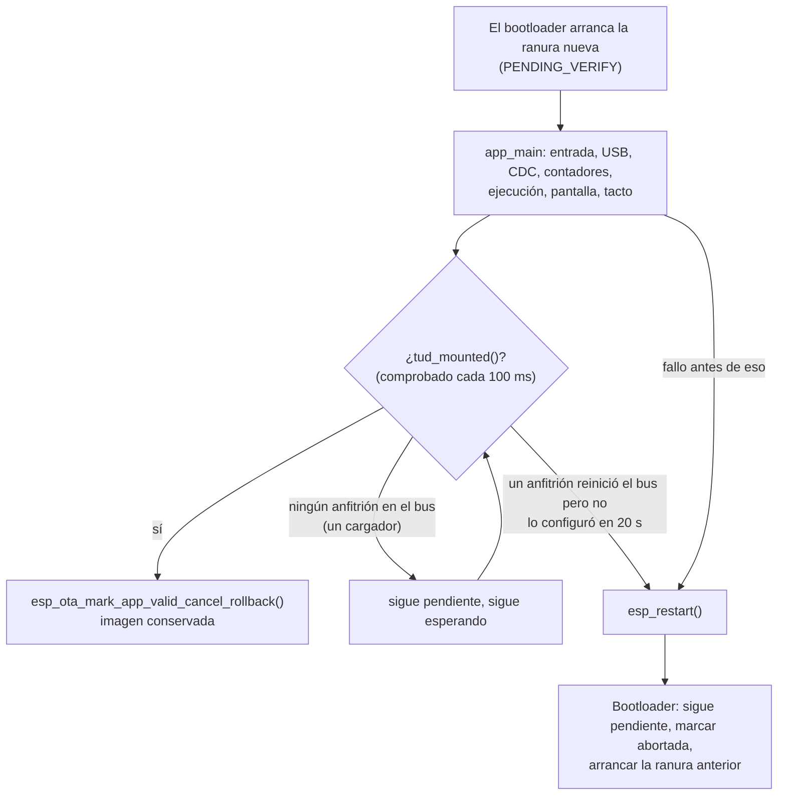
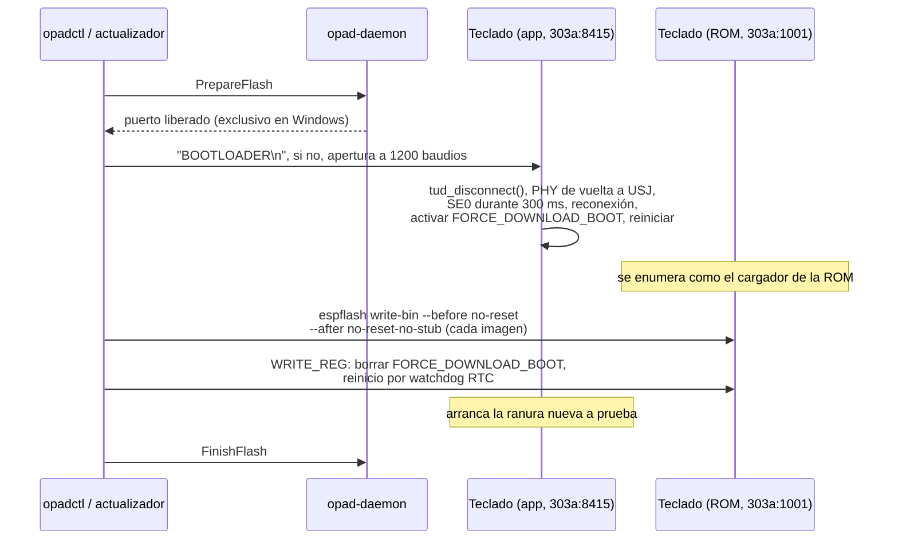

Un teclado se actualiza, se flashea y se recupera solo por USB. Nunca se pide a nadie que pulse BOOT o RESET ([AGENTS.md](https://github.com/OPad-dev/OPad/blob/main/AGENTS.md) §1.5). Eso descarta la red de seguridad habitual ante un flasheo fallido, así que el firmware tiene que aportar la suya: **una actualización no puede dejar inservible un teclado.** Dos capas lo garantizan:

1. **Dos ranuras de app con arranque de prueba.** Una imagen nueva va a la ranura que el teclado *no* está ejecutando, arranca una vez a prueba y solo se conserva si un anfitrión configura su USB. Si no, el bootloader vuelve por sí solo a la anterior.
2. **El bootloader de la ROM como último recurso.** Un teclado cuya app nunca se enumera lo captura `opadctl pad recover` durante su siguiente arranque, en el cargador USB de la ROM de máscara, que ningún contenido de la flash puede romper.

<!-- src: /firmware/main/app_main.c#confirm_image_once_usb_works, /desktop/crates/opad-device/src/flash.rs#recover -->

## Dos ranuras

[partitions.csv](https://github.com/OPad-dev/OPad/blob/main/firmware/partitions.csv) tiene dos ranuras de app de 2 MB, y el bootloader se compila con soporte de reversión (`CONFIG_BOOTLOADER_APP_ROLLBACK_ENABLE=y` en [sdkconfig.defaults](https://github.com/OPad-dev/OPad/blob/main/firmware/sdkconfig.defaults)):

| Partición | Tipo | Desplazamiento | Tamaño | Contiene |
|---|---|---|---|---|
| `nvs` | data, nvs | `0x9000` | 24 KB | Ajustes, dueño, calibración, diseños, contadores de por vida |
| `otadata` | data, ota | `0xf000` | 8 KB | Qué ranura arranca y su estado (dos sectores de 4 KB) |
| `phy_init` | data, phy | `0x11000` | 4 KB | Datos de calibración de RF |
| `ota_0` | app | `0x20000` | 2 MB | Ranura de app 0 (`APP_PARTITION_OFFSET` en [flash.rs](https://github.com/OPad-dev/OPad/blob/main/desktop/crates/opad-device/src/flash.rs)) |
| `ota_1` | app | `0x220000` | 2 MB | Ranura de app 1 (`OTA_1_OFFSET`) |

`nvs` se quedó en su desplazamiento y tamaño originales cuando se añadieron las ranuras: moverla habría hecho perder los contadores y el dueño de todos los teclados.

El anfitrión planifica una actualización con [`plan_app_update()`](https://github.com/OPad-dev/OPad/blob/main/desktop/crates/opad-device/src/flash.rs):

1. El teclado informa de la ranura desde la que arrancó en `HelloAck.running_partition`.
2. La imagen nueva va a la **otra** ranura (`ota_1` si se ejecuta `ota_0`, y al revés), así que la imagen que funciona nunca se toca. Un teclado que ejecutó una actualización desde `ota_1` recibe la siguiente en `ota_0` ([`is_ota_slot()`](https://github.com/OPad-dev/OPad/blob/main/desktop/crates/opad-update/src/firmware.rs)).
3. [`otadata_image()`](https://github.com/OPad-dev/OPad/blob/main/desktop/crates/opad-device/src/flash.rs) construye un `otadata` nuevo: el sector 0 conserva la ranura antigua como `OTA_IMG_VALID` y el sector 1 selecciona la nueva con un número de secuencia mayor como `OTA_IMG_NEW`. Cada entrada lleva el CRC-32 que comprueba el bootloader (`otadata_crc`).
4. Primero se escribe la imagen de la app y después `otadata`, así que una escritura interrumpida deja seleccionada la ranura antigua y arranca la imagen antigua.

Dos casos quedan fuera de esto. Un teclado que no informa de ninguna ranura OTA (firmware demasiado antiguo para decirlo, o la disposición `factory` anterior a OTA) no puede recibir una actualización desde el actualizador de la app, que informa `NeedsFullReflash` y pide un `opadctl pad flash --full` por única vez. Y `opadctl pad flash` sin el daemon en marcha no puede saber la ranura en ejecución, así que lo indica, escribe `ota_0` y deja en blanco la selección de arranque para que arranque `ota_0`, sin alternativa.

## El arranque de prueba

El bootloader arranca una vez una ranura `OTA_IMG_NEW` y la marca como `ESP_OTA_IMG_PENDING_VERIFY`. A partir de ahí, la imagen tiene que confirmarse a sí misma; una imagen que sigue pendiente en el siguiente reinicio se marca como abortada y arranca la ranura `VALID` anterior.

Qué cuenta como "funcionar" es la decisión importante. Arrancar no basta: una imagen que arranca, ejecuta sus tareas y nunca se convierte en un teclado USB es justo la imagen que dejaría inservible un teclado. Por eso [`confirm_image_once_usb_works()`](https://github.com/OPad-dev/OPad/blob/main/firmware/main/app_main.c), lo último que hace `app_main`, solo confirma cuando **un anfitrión ha configurado el USB**:

- La ventana de 20 s (`IMAGE_CONFIRM_TIMEOUT_US`) empieza cuando se conecta un anfitrión (`tud_connected()`), no en el arranque.
- En un cargador o una batería externa nunca se conecta un anfitrión, así que la imagen ni se confirma ni se revierte: sigue pendiente hasta la próxima vez que se conecte a un ordenador. Un teclado usado lejos de un PC nunca se revierte por falta de uno.
- Un bucle de fallos se revierte del mismo modo, porque cada fallo es un reinicio de una imagen sin confirmar.
- Un reinicio pedido por el anfitrión espera a que la imagen esté confirmada (`image_confirmed()` en [runtime.c](https://github.com/OPad-dev/OPad/blob/main/firmware/main/runtime/runtime.c)); si no, el propio reinicio la revertiría.

## Entrar en el bootloader por USB

La app controla el PHY USB con TinyUSB; el cargador de la ROM con el que habla `espflash` usa el USB-Serial-JTAG integrado en el chip. Pasar de uno a otro sin botón es un intercambio entre el daemon, el firmware y el flasheador ([`enter_bootloader()`](https://github.com/OPad-dev/OPad/blob/main/desktop/crates/opad-device/src/flash.rs), [`reboot_to_rom_download()`](https://github.com/OPad-dev/OPad/blob/main/firmware/main/usb/usb_cdc.c)):

1. El daemon tiene abierto el puerto serie del teclado, así que `opadctl pad flash` le pide primero que lo suelte (`IpcRequest::PrepareFlash`; el actualizador llama a `pause_and_release()`). En Windows un manejador serie es exclusivo, así que es imprescindible.
2. `enter_bootloader()` prueba dos disparadores por turno (`BOOT_TRIGGERS`): la orden de texto `BOOTLOADER\n` en el puerto CDC y, después, abrir el puerto a 1200 baudios.
3. El firmware vacía el CDC, llama a `tud_disconnect()`, devuelve el PHY al USB-Serial-JTAG y mantiene SE0 (ambas líneas a nivel bajo) durante 300 ms para que el anfitrión vea una desconexión real. Se reconecta, restaurando el pull-up de D+ *antes* de quitar la anulación de pulls, espera hasta 1,5 s el reinicio de bus del anfitrión, activa `RTC_CNTL_FORCE_DOWNLOAD_BOOT` y reinicia en el cargador de la ROM. Cada uno de esos detalles corrigió un fallo real; [AGENTS.md](https://github.com/OPad-dev/OPad/blob/main/AGENTS.md) §6 los enumera.
4. [`write_images()`](https://github.com/OPad-dev/OPad/blob/main/desktop/crates/opad-device/src/flash.rs) ejecuta `espflash write-bin --chip esp32s3 --before no-reset --after no-reset-no-stub --non-interactive` una vez por imagen, sin salir del stub del flasheador entre ellas.
5. [`reset_to_app()`](https://github.com/OPad-dev/OPad/blob/main/desktop/crates/opad-device/src/flash.rs) sale por sí mismo del modo de descarga: envía órdenes SLIP `WRITE_REG` que borran `FORCE_DOWNLOAD_BOOT` y provocan un reinicio por watchdog RTC. espflash no puede hacerlo en el S3: su propio `--after watchdog-reset` no hace nada allí, sin avisar, y se niega a reiniciar un chip con ese bit activo.
6. El daemon se reanuda (`IpcRequest::FinishFlash`) y espera a que vuelva el teclado.

Si la app nueva nunca se enumera, el arranque de prueba la revierte. Si ni siquiera eso puede ocurrir (el bootloader o la propia tabla de particiones están rotos), `opadctl pad recover` espera al siguiente arranque del teclado, lo captura en el cargador de la ROM en cuanto aparece, lo retiene en modo de descarga y escribe el conjunto completo de imágenes. El procedimiento está en [Recuperación](../recovery.md) §7.6–7.7.

## Actualizaciones de la app y de tosu

Las ofertas de app, tosu incluido y firmware salen de un único feed firmado, que leen [opad-update](https://github.com/OPad-dev/OPad/blob/main/desktop/crates/opad-update/src/lib.rs) y el trabajador de actualizaciones del daemon ([updater.rs](https://github.com/OPad-dev/OPad/blob/main/desktop/daemon/src/updater.rs)). Cómo se construye y se publica el feed está en [Canalizaciones de publicación](../develop/releases.md).

- **Nada cambia durante un mapa.** Todo actualizador pregunta antes a [`may_update_now()`](https://github.com/OPad-dev/OPad/blob/main/desktop/crates/opad-update/src/gate.rs), que solo permite `Idle`: sustituir un binario o flashear a mitad de mapa es el mismo peligro que escribir en flash a mitad de mapa, pero con más fuerza.
- **Calendario y canal.** El trabajador se despierta cada 15 minutos (`TICK`) y consulta el feed una vez al día ([schedule.rs](https://github.com/OPad-dev/OPad/blob/main/desktop/crates/opad-update/src/schedule.rs)), espaciando los intentos tras los fallos. Los usuarios eligen `stable` (por defecto) o `beta` en **Settings → Updates & Firmware**. Los despliegues escalonados se reparten por ID de instalación (`rollout::for_install`).
- **Verificado antes de usarse.** Los bytes del feed se comprueban contra una firma minisign y la clave compilada antes de analizarlos; la clave pública de pruebas solo se acepta con `OPAD_TRUST_TEST_KEY=1` (o, para el asistente de actualización con root, el archivo `/etc/opad/trust-test-key`, propiedad de root). Cada archivo descargado tiene que coincidir con el SHA-256 que le asigna el feed firmado ([verify.rs](https://github.com/OPad-dev/OPad/blob/main/desktop/crates/opad-update/src/verify.rs)), y se escribe en un archivo temporal que luego se renombra a su sitio, así que nunca se instala un binario a medio escribir.
- **Se aplica según cómo se hizo la instalación.** El marcador `install-origin` elige el método ([origin.rs](https://github.com/OPad-dev/OPad/blob/main/desktop/crates/opad-update/src/origin.rs)); la tabla por paquete está en [Empaquetado](../develop/packaging.md).
  - `windows`: el nuevo instalador Inno Setup con `/SILENT /NORESTART /RELAUNCH=1` ([`apply_command()`](https://github.com/OPad-dev/OPad/blob/main/desktop/crates/opad-update/src/app.rs)). Una actualización automática lo deja preparado (`STAGED_KEY`) y lo ejecuta en el siguiente inicio; **Install now** lo ejecuta en el acto.
  - `deb`, `rpm`, `aur`: `pkexec /usr/lib/opad/opad-update-helper`, que una acción de polkit permite ejecutar sin contraseña al usuario sentado ante el ordenador. Como eso convierte al asistente en una puerta a root, solo instala una versión de OPad más nueva que nombre el feed firmado, y comprueba la firma, el SHA-256 del paquete y la propia versión antes de llamar a `apt-get`, `dnf` o `pacman -U` ([helper.rs](https://github.com/OPad-dev/OPad/blob/main/desktop/crates/opad-update/src/helper.rs)).
  - `appimage`, `user`: el archivo AppImage se sustituye de forma atómica, o el archivo comprimido se extrae sobre el prefijo de instalación.
  - `source`, o un marcador ausente o desconocido: solo se avisa; no se modifica nada.
- **Nunca un reinicio por sorpresa.** Con **Install OPad updates automatically** activado (por defecto), una actualización de la app se instala mientras no se juega ningún mapa, pero el OPad en ejecución no se reinicia: la GUI muestra "OPad *version* is installed and runs the next time OPad starts." (en Windows, "…is ready and installs the next time OPad starts."). El tosu incluido solo se actualiza por sí mismo donde OPad es dueño del binario (`windows`, `user`, `appimage`).
- **El firmware espera a un teclado sin uso.** Con **Install firmware updates automatically** activado (por defecto), el daemon flashea un firmware nuevo cuando el teclado lleva 30 minutos sin usarse (`AUTO_IDLE` en [firmware_update.rs](https://github.com/OPad-dev/OPad/blob/main/desktop/daemon/src/firmware_update.rs)); **Update now** sigue preguntando antes.
