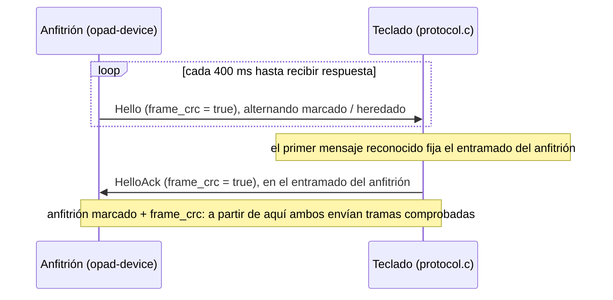

El daemon se comunica con el teclado por su puerto serie USB CDC-ACM (abierto a 115200 baudios). Cada mensaje es una envolvente de Protocol Buffers v3, `HostToDevice` o `DeviceToHost`, de `protocol/opad.proto`, dentro de una trama con prefijo de longitud. El teclado codifica con nanopb y el anfitrión con prost.
<!-- src: /protocol/opad.proto, /desktop/crates/opad-protocol/src/lib.rs, /desktop/crates/opad-device/src/lib.rs, /firmware/main/protocol/protocol.c -->

La aplicación y el teclado se actualizan por separado, así que ambos extremos hablan todos los entramados y las combinaciones de versiones antiguas y nuevas siguen funcionando (consulta [Interoperabilidad de versiones de la app y del teclado](../explanation/app-and-pad-versions.md)).
<!-- src: /desktop/crates/opad-protocol/src/lib.rs#Framing -->

## Entramado

Los tres entramados tienen una cabecera de 4 bytes.
<!-- src: /firmware/main/protocol/frame_parser.h, /desktop/crates/opad-protocol/src/lib.rs#Framing -->

| Entramado | Formato | Uso |
|---|---|---|
| Heredado (legacy) | `[len u32 LE][payload]` | Aplicaciones y firmware anteriores al marcador |
| Marcado | `[0xAA 0x55][len u16 LE][payload]` | Predeterminado |
| Comprobado | `[0xAA 0x5A][len u16 LE][payload][CRC-16 LE]` | Una vez que ambos extremos lo acuerdan en el handshake |
<!-- src: /firmware/main/protocol/frame_parser.h#FRAME_MAGIC_0, /desktop/crates/opad-protocol/src/lib.rs#FRAME_MAGIC, /desktop/crates/opad-protocol/src/lib.rs#FRAME_MAGIC_CHECKED -->

Los entramados no se pueden confundir: una cabecera heredada que empiece por `AA 55` o `AA 5A` declararía al menos `0x55AA` bytes, más de lo que puede contener cualquier trama.
<!-- src: /firmware/main/protocol/frame_parser.h -->

### Límites

| Límite | Valor | Origen |
|---|---|---|
| Cabecera | 4 bytes | `HEADER_BYTES`, `FRAME_HEADER_SIZE` |
| Cola de CRC (solo comprobado) | 2 bytes | `CRC_BYTES`, `FRAME_CRC_SIZE` |
| Carga útil máxima | 8186 bytes (8192 − 4 − 2) | `MAX_PAYLOAD_BYTES`, `FRAME_MAX_PAYLOAD` |
| Carga útil heredada mínima | 2 bytes, para que las rachas de bytes a cero nunca se lean como tramas vacías | `LEGACY_MIN_PAYLOAD`, `FRAME_LEGACY_MIN_PAYLOAD` |
| Trama máxima que envía el teclado | 1024 bytes con cabecera y CRC, para que una trama siempre quepa entera en la FIFO de TX del CDC | `send_envelope` |
| Trama parcial obsoleta | Se descarta tras 500 ms sin bytes | `RX_STALE_US`, `STALE_PARTIAL_FRAME` |
<!-- src: /desktop/crates/opad-protocol/src/lib.rs#MAX_PAYLOAD_BYTES, /firmware/main/protocol/frame_parser.h#FRAME_MAX_PAYLOAD, /firmware/main/protocol/protocol.c#send_envelope, /firmware/main/protocol/protocol.c#RX_STALE_US, /desktop/crates/opad-device/src/lib.rs#STALE_PARTIAL_FRAME -->

### CRC-16

Las tramas comprobadas llevan un CRC-16/CCITT-FALSE sobre los dos bytes de longitud y la carga útil (no el marcador), de modo que una longitud dañada también falla. Se añade en little-endian.
<!-- src: /firmware/main/protocol/frame_parser.c#checked_crc, /desktop/crates/opad-protocol/src/lib.rs#checked_crc -->

| Parámetro | Valor |
|---|---|
| Polinomio | `0x1021` |
| Valor inicial | `0xFFFF` |
| RefIn / RefOut | `false` / `false` |
| XorOut | `0x0000` |
| Comprobación (`"123456789"`) | `0x29B1` |
<!-- src: /firmware/main/protocol/frame_parser.c#frame_crc16, /desktop/crates/opad-protocol/src/lib.rs#crc16 -->

### Resincronización

Ambos analizadores saltan los bytes que no pueden iniciar una trama:

- Un marcador cuya longitud supera 8186 no es una cabecera: se salta un byte.
- Una trama comprobada con un CRC erróneo, o una carga útil que no se decodifica, se descarta solo por su primer byte, de modo que una trama real pegada detrás de una truncada se sigue encontrando.
- Una vez conocido el entramado, el analizador queda fijado a él. Fijado a marcado, salta directamente al siguiente `0xAA`; fijado a heredado, solo se acepta una cabecera cuando sus dos bytes de longitud superiores son cero.
- El teclado descarta una trama parcial obsoleta tras 500 ms. Una parcial comprobada se descarta de un byte en un byte para que las tramas completas que vienen detrás sigan llegando.
<!-- src: /firmware/main/protocol/frame_parser.c#scan, /firmware/main/protocol/frame_parser.c#frame_parser_expire, /desktop/crates/opad-protocol/src/lib.rs#resync, /desktop/crates/opad-protocol/src/lib.rs#decode_frame -->

## Handshake y negociación del entramado

1. Mientras desconoce el entramado del teclado, el anfitrión envía `Hello` cada 400 ms (`HELLO_RETRY`), alternando entramado marcado y heredado. `Hello` lleva `config_revision = 1` (`CONFIG_REVISION`: el conjunto más nuevo de valores de ajustes que conoce la app; el teclado conserva cualquier ajuste cuyo valor guardado sea más nuevo, envíe lo que envíe la app), `protocol_version = 1`, `he_calibration = true` y `frame_crc = true`.
2. El teclado no envía nada hasta haber decodificado un mensaje que reconoce. El entramado de esa trama pasa a ser el entramado del anfitrión durante la conexión (una trama comprobada cuenta como marcada), y el analizador queda fijado a él.
3. El teclado responde a `Hello` con `HelloAck` en ese entramado. `HelloAck.frame_crc` es verdadero cuando el `Hello` pidió tramas comprobadas y el entramado es marcado; el propio `HelloAck` sigue siendo una trama marcada, y todas las tramas posteriores son comprobadas.
4. Con `HelloAck.frame_crc = true`, el anfitrión también envía tramas comprobadas. El firmware anterior a `frame_crc` ignora el campo, y ambos extremos se quedan en tramas marcadas.
5. Tras 10 `Hello` sin respuesta (`HELLOS_BEFORE_REOPEN`), el anfitrión cierra y vuelve a abrir el puerto. Al cerrar el puerto cae DTR, y el teclado olvida entonces el entramado y el acuerdo de CRC.
<!-- src: /desktop/crates/opad-device/src/lib.rs#Handshake, /desktop/crates/opad-device/src/lib.rs#hello_framing, /desktop/crates/opad-device/src/lib.rs#hello_message, /firmware/main/protocol/protocol.c#on_frame_received, /firmware/main/protocol/protocol.c#handle_host_message, /firmware/main/protocol/protocol.c#protocol_reset_rx -->

Un anfitrión que lee un `HelloAck.protocol_version` distinto de `1` (`DEVICE_PROTOCOL_VERSION`) deja el teclado en paz y lo marca como incompatible.
<!-- src: /desktop/crates/opad-protocol/src/lib.rs#DEVICE_PROTOCOL_VERSION -->

### Indicadores de capacidad

Las funciones nuevas se anuncian en `HelloAck` en lugar de por número de versión. El firmware anterior a un indicador envía su valor predeterminado (`false` / `0`), y entonces el anfitrión prescinde de esa función.
<!-- src: /protocol/opad.proto#HelloAck -->

| Campo de `HelloAck` | Significado cuando está activo |
|---|---|
| `key_press_times` | El teclado envía `KeyPressBatch` durante un mapa; si no, el anfitrión mide el ritmo de pulsación a partir de tosu. |
| `board_test` | El teclado responde a `run_board_test`. |
| `builtin_animations` | Id más alto de las animaciones de resultado integradas; `0` = sin `PlayAnimation`. |
| `restart` | El teclado atiende `restart`. |
| `he_input` | Firmware compilado con el backend Hall Effect (no dice nada del módulo conectado). |
| `he_calibration` | Un backend Hall Effect activo con calibración interactiva. |
| `he_live` | El teclado transmite `HeLiveSample` con `he_live_view`. |
| `tap_rate_per_second` | El teclado muestra en teclas por segundo los widgets de ritmo de pulsación marcados con `UI_FLAG_PER_SECOND`. |
| `key_count` | Teclas que lee el teclado: `3` con un módulo Hall Effect V3, si no `2`; `0` se interpreta como `2`. |
| `input_module` | El módulo encontrado al arrancar (`InputModule`); `UNKNOWN` en firmware antiguo. |
| `frame_crc` | El teclado pasó a tramas comprobadas. |
| `ota_chunk_max` | El teclado acepta una imagen de aplicación nueva por esta conexión, en trozos de hasta este número de bytes (4096); `0` = se flashea por el bootloader de la ROM. |
<!-- src: /protocol/opad.proto#HelloAck -->

## Envolventes

Ambas envolventes llevan un `sequence_number` y un `payload`:
<!-- src: /protocol/opad.proto#HostToDevice, /protocol/opad.proto#DeviceToHost -->

| Etiqueta | `HostToDevice.payload` |
|---|---|
| 2 | `Hello hello` |
| 3 | `SetConfig set_config` |
| 4 | `TimeSync time_sync` |
| 5 | `GameplayDisplayState gameplay_state` |
| 6 | `CounterSyncRequest counter_sync` |
| 7 | `bool request_status` |
| 8 | `HostStatus host_status` |
| 9 | `bool reset_latency_stats` |
| 10 | `DataUpdate data_update` |
| 11 | `SetLayout set_layout` |
| 12 | `uint32 reset_layout` |
| 13 | `bool request_logs` |
| 14 | `ClaimOwnership claim_ownership` |
| 15 | `DetectPinRequest detect_pin` |
| 16 | `bool run_board_test` |
| 17 | `PlayAnimation play_animation` |
| 18 | `bool restart` |
| 19 | `bool start_he_calibration` |
| 20 | `bool cancel_he_calibration` |
| 21 | `bool he_live_view` |
| 22 | `OtaBegin ota_begin` |
| 23 | `OtaChunk ota_chunk` |
| 24 | `OtaEnd ota_end` |
| 25 | `bool ota_abort` |

| Etiqueta | `DeviceToHost.payload` |
|---|---|
| 2 | `HelloAck hello_ack` |
| 3 | `DeviceStatus status` |
| 4 | `ConfigAck config_ack` |
| 5 | `CounterSyncResponse counter_sync_resp` |
| 6 | `LogEventBatch log_batch` |
| 7 | `LayoutAck layout_ack` |
| 8 | `DetectPinResponse detect_pin_resp` |
| 9 | `KeyPressBatch key_presses` |
| 10 | `BoardTestResult board_test` |
| 11 | `HeCalibrationProgress he_calibration_progress` |
| 12 | `HeLiveSample he_live_sample` |
| 13 | `OtaStatus ota_status` |
<!-- src: /protocol/opad.proto#HostToDevice, /protocol/opad.proto#DeviceToHost -->

## Catálogo de mensajes

### Sesión y estado

| Mensaje | Dirección | Propósito |
|---|---|---|
| `Hello` / `HelloAck` | anfitrión → teclado / teclado → anfitrión | Handshake. `HelloAck` también lleva `firmware_version`, `board_profile`, `device_id`, `counter_generation`, los totales de por vida de las teclas 1 y 2, el `owner_id` de 16 bytes, `running_partition` (`ota_0`, `ota_1`, `factory`, o vacío en firmware anterior a la tabla de dos ranuras), `current_config` y los indicadores de capacidad de arriba. |
| `ClaimOwnership` | anfitrión → teclado | Registra un ID de propietario de 16 bytes en NVS. Se rechaza fuera de `IDLE` y si el ID falta o es todo ceros. |
| `request_status` → `DeviceStatus` | anfitrión → teclado → anfitrión | Tiempo encendido, `DeviceState`, brillo, pantalla en reposo, conteos de por vida y por mapa de las teclas 1–3, latencia medida en el teclado (`latency_samples`, `latency_p50_us`, `latency_p99_us`, `latency_p999_us`, `latency_max_us`, `hid_deferred_reports`), `display_ok`, `nvs_ok`, `nvs_writes` y `HeCalibrationStatus`. |
| `HostStatus` | anfitrión → teclado | `tosu_connected`, `playing`, `play_id` (un valor nuevo pone a cero los contadores del mapa) y `osu_active` (los deslizamientos de volumen van a osu!). Se envía cada segundo (`HOST_STATUS_INTERVAL`) y en cada cambio. |
| `TimeSync` | anfitrión → teclado | Fecha y hora de reloj. |
| `restart` | anfitrión → teclado | Reinicia en cuanto está en `IDLE` y la imagen en ejecución está confirmada. Antes, el teclado guarda contadores, configuración, diseños y calibración. Sin respuesta: se vuelve a conectar. |
<!-- src: /protocol/opad.proto#HelloAck, /protocol/opad.proto#DeviceStatus, /protocol/opad.proto#HostStatus, /firmware/main/config/device_config.h#device_config_claim_owner, /firmware/main/runtime/runtime.c#restart_now, /desktop/daemon/src/runtime.rs#HOST_STATUS_INTERVAL -->

### Configuración

| Mensaje | Dirección | Propósito |
|---|---|---|
| `SetConfig` → `ConfigAck` | anfitrión → teclado → anfitrión | `SetConfig` lleva un `ConfigPayload`; `ConfigAck` devuelve `success`, un `message` (el error de validación) y la `current_config` del teclado. La escritura en NVS espera a `IDLE`. Campos, rangos y reglas de «mantener el valor actual»: [Referencia de ajustes del dispositivo](device-settings.md). |
| `DetectPinRequest` → `DetectPinResponse` | anfitrión → teclado → anfitrión | Escucha durante `timeout_ms` un interruptor en cualquier pin permitido salvo `exclude_gpio` y comunica el GPIO para `key_id` (`0` = ninguno). |
<!-- src: /protocol/opad.proto#SetConfig, /protocol/opad.proto#ConfigAck, /protocol/opad.proto#DetectPinRequest -->

### Pantalla

| Mensaje | Dirección | Propósito |
|---|---|---|
| `DataUpdate` | anfitrión → teclado | Solo los valores de datos de la interfaz que cambiaron (`DataValue`: id de `source` más `number`, `text` o `clear`), como mucho 32 por mensaje. El anfitrión reenvía todos los valores tras una reconexión. |
| `SetLayout` → `LayoutAck` | anfitrión → teclado → anfitrión | Un diseño de pantalla: `screen`, `background` (`0xRRGGBB`), como mucho 32 `UiWidget`. |
| `reset_layout` | anfitrión → teclado | Devuelve ese id de pantalla a su diseño integrado. |
| `PlayAnimation` | anfitrión → teclado | `animation` (`0` detiene, `1`–`127` integradas, `128 + n` reservadas para subidas) con una cadena `grade`. Se ignora durante un mapa y se detiene cuando empieza uno. |
| `GameplayDisplayState` | anfitrión → teclado | Sigue en el esquema. El daemon actual nunca lo envía y el firmware actual lo ignora. |
<!-- src: /protocol/opad.proto#DataUpdate, /protocol/opad.proto#SetLayout, /protocol/opad.proto#PlayAnimation, /protocol/opad.options, /firmware/main/protocol/protocol.c#handle_host_message -->

### Contadores, registros y diagnóstico

| Mensaje | Dirección | Propósito |
|---|---|---|
| `CounterSyncRequest` → `CounterSyncResponse` | anfitrión → teclado → anfitrión | Concilia los contadores de por vida (`CounterState`; `lifetime_key3` solo al restaurar una copia de seguridad que lo tenga) o, con `force_restore`, los restaura. |
| `KeyPressBatch` | teclado → anfitrión | Pulsaciones de las teclas de juego desde el último lote (`KeyPress`: `key`, `t_us` en el reloj del teclado), `now_us` y `dropped`. Solo se envía mientras `HostStatus.playing`, desde la tarea del protocolo, nunca desde la ruta de entrada. |
| `reset_latency_stats` | anfitrión → teclado | Borra las estadísticas de latencia del teclado. |
| `request_logs` → `LogEventBatch` | anfitrión → teclado → anfitrión | Eventos de diagnóstico, como mucho 8 por lote. |
| `run_board_test` → `BoardTestResult` | anfitrión → teclado → anfitrión | Mediciones de las PCB de la placa portadora y del módulo en `IDLE`: tensiones de ID de módulo, `InputModule` al arrancar y actual, `cable_reversed`, GPIO de las teclas, máscaras de pines con pull-up, pull-down y puenteados, y en Hall Effect V3 un `HeAdcTest` (estado del ADS7028, recorrido de registros, calibración de offset, barrido de SCLK, tres ráfagas de sensores). |
<!-- src: /protocol/opad.proto#CounterSyncRequest, /protocol/opad.proto#KeyPressBatch, /protocol/opad.proto#BoardTestResult, /protocol/opad.proto#HeAdcTest -->

### Hall Effect

| Mensaje | Dirección | Propósito |
|---|---|---|
| `HeKeySettings` | dentro de `ConfigPayload` | Ajustes de recorrido por tecla y `HeRtMode` (consulta la [Referencia de ajustes del dispositivo](device-settings.md#teclas-hall-effect-he_cfg-he_cfg3)). |
| `HeCalibrationStatus` | dentro de `DeviceStatus` | Indicador de calibrada y lecturas de reposo/fondo por tecla para las teclas 1–3, `is_locked`, `is_calibrating`, `noise_floor_rest`, `noise_floor_movement`. |
| `start_he_calibration` / `cancel_he_calibration` | anfitrión → teclado | Inicia o cancela la calibración interactiva. |
| `HeCalibrationProgress` | teclado → anfitrión | `HeCalStage`, `key_index` (`1`–`3`, `0` en reposo o al terminar), `presses_done` (`0`–`5`), `HeCalError`, `error_message`, `raw_value` y, si tiene éxito, reposo/fondo por tecla. Los inicios rechazados comunican `stage = FAILED`, `error = NONE` con un mensaje. |
| `he_live_view` → `HeLiveSample` | anfitrión → teclado → anfitrión | `true` transmite lecturas crudas y el estado de pulsación de cada tecla unas 50 veces por segundo (`HE_LIVE_PERIOD_US` = 20 ms) durante los 2 s siguientes (`HE_LIVE_KEEPALIVE_US`); hay que reenviarlo para mantenerlo, y `false` lo detiene. Nunca se transmite durante un mapa ni su enfriamiento. |
<!-- src: /protocol/opad.proto#HeCalibrationStatus, /protocol/opad.proto#HeCalibrationProgress, /protocol/opad.proto#HeLiveSample, /firmware/main/protocol/protocol.c#HE_LIVE_PERIOD_US -->

### Actualización del firmware por USB

El teclado sigue funcionando como teclado y reproduce su animación `updating` mientras escribe la ranura de aplicación que no está ejecutando. Se rechaza fuera de `IDLE`; se abandona si empieza un mapa o el anfitrión calla 10 s (`OTA_IDLE_TIMEOUT_US`), y la imagen en ejecución queda como estaba.

| Mensaje | Dirección | Propósito |
|---|---|---|
| `OtaBegin { image_size, sha256 }` → `OtaStatus READY` | anfitrión → teclado → anfitrión | Responde enseguida; cada bloque de 64 KB de la otra ranura se borra cuando las escrituras llegan a él. |
| `OtaChunk { offset, data }` → `OtaStatus WRITTEN` | anfitrión → teclado → anfitrión | El trozo siguiente; `offset` tiene que ser donde acabó el anterior. `written` es el total hasta ahora. El anfitrión mantiene dos en vuelo. Un trozo que no empieza ahí (uno anterior se perdió por el camino) recibe `RESEND` con lo escrito, y no se escribe nada de él; el anfitrión vuelve a enviar desde ahí, como hace tras 3 s sin respuesta, hasta 5 veces seguidas. |
| `OtaEnd` → `OtaStatus DONE` | anfitrión → teclado → anfitrión | Comprueba tamaño, SHA-256 y la imagen, hace que la ranura nueva arranque una vez a prueba (se revierte si no configura el USB) y se reinicia en ella; su último frame de la animación se queda hasta que empieza el clip de boot. |
| `ota_abort` | anfitrión → teclado | Abandonar; la imagen en ejecución queda como estaba. |
| `OtaStatus ERROR` | teclado → anfitrión | La transferencia terminó; `message` dice por qué. |
<!-- src: /protocol/opad.proto#OtaBegin, /firmware/main/ota/ota_usb.c, /desktop/crates/opad-device/src/ota.rs -->

## Límites de tamaño de nanopb

Las cadenas, los bytes y los campos repetidos tienen límites fijos en `protocol/opad.options`, de modo que el firmware codifica y decodifica sin reservar memoria dinámica.
<!-- src: /protocol/opad.options -->

| Campo | Límite |
|---|---|
| `Hello.client_version` | 32 bytes |
| `HelloAck.firmware_version`, `.board_profile`, `.device_id` | 32 bytes cada uno |
| `HelloAck.owner_id`, `ClaimOwnership.owner_id` | 16 bytes |
| `HelloAck.running_partition` | 17 bytes |
| `ConfigAck.message`, `LayoutAck.message`, `CounterSyncResponse.message` | 64 bytes cada uno |
| `GameplayDisplayState.title`, `.artist` | 64 bytes cada uno |
| `GameplayDisplayState.difficulty` | 32 bytes |
| `DataValue.text` | 64 bytes |
| `DataUpdate.values` | 32 entradas |
| `UiWidget.label` | 32 bytes |
| `UiWidget.suffix` | 12 bytes |
| `SetLayout.widgets` | 32 entradas |
| `PlayAnimation.grade` | 4 bytes |
| `CounterState.device_id` | 32 bytes |
| `LogEvent.tag` | 16 bytes |
| `LogEvent.message` | 64 bytes |
| `LogEventBatch.events` | 8 entradas |
| `KeyPressBatch.presses` | 32 entradas |
| `BoardTestResult.message` | 64 bytes |
| `HeAdcTest.message` | 48 bytes |
| `HeAdcTest.speeds` | 6 entradas |
| `HeAdcTest.channels` | 3 entradas |
| `HeCalibrationProgress.error_message` | 48 bytes |
| `OtaBegin.sha256` | 32 bytes |
| `OtaChunk.data` | 4096 bytes |
| `OtaStatus.message` | 48 bytes |
<!-- src: /protocol/opad.options -->

Para cambiar un mensaje, consulta [Cambios de protocolo y evolución del esquema](../develop/protocol-changes.md).
