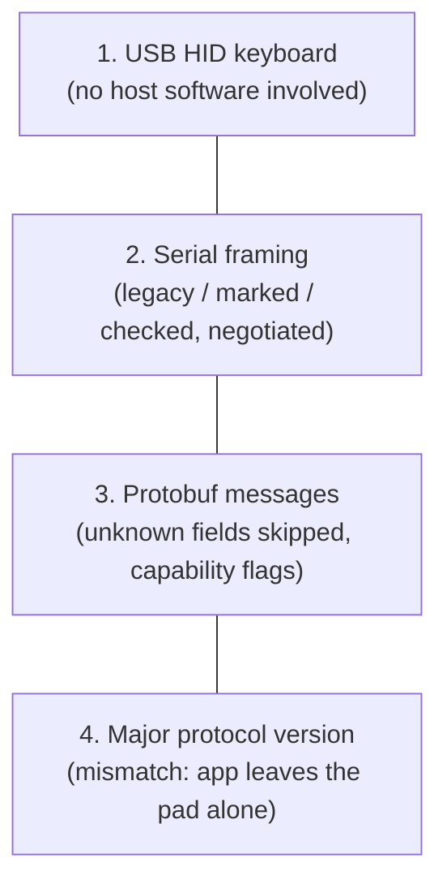
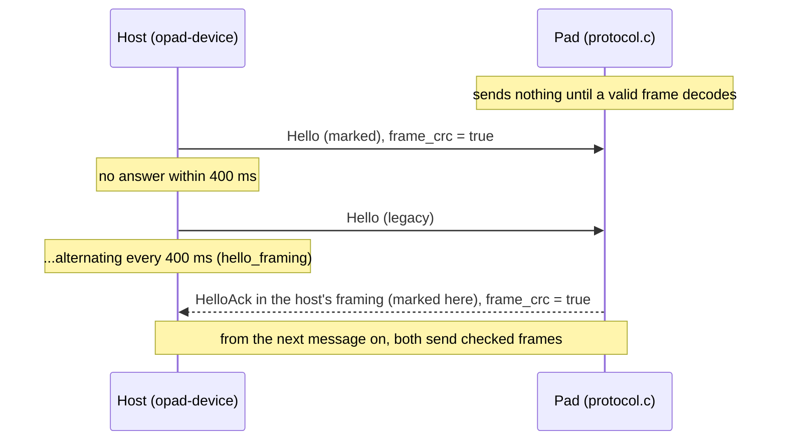

The desktop app and the pad's firmware update on their own schedules ([AGENTS.md](https://github.com/OPad-dev/OPad/blob/main/AGENTS.md) §1.3). A user may update the app and not the pad for months, or flash a newer pad and keep an old app. Every combination has to work, and the user is never told to "update both together".

That works in layers, each of which degrades on its own:

1. **The keyboard needs no software.** The pad enumerates as a standard 1000 Hz USB HID keyboard ([usb_descriptors.c](https://github.com/OPad-dev/OPad/blob/main/firmware/main/usb/usb_descriptors.c)). No version of the app can break typing ([AGENTS.md](https://github.com/OPad-dev/OPad/blob/main/AGENTS.md) §1.2).
2. **Framing is negotiated**, so an old peer is never sent bytes it cannot parse.
3. **Messages evolve additively**, and features are announced, not assumed.
4. **A real break is detected**, and the app then stays out of the pad's way.

## Framing: the pad answers in the host's framing

The serial link has used three framings over time ([`Framing`](https://github.com/OPad-dev/OPad/blob/main/desktop/crates/opad-protocol/src/lib.rs), [frame_parser.c](https://github.com/OPad-dev/OPad/blob/main/firmware/main/protocol/frame_parser.c)): legacy (unmarked, length then payload), marked (`0xAA 0x55`, length, payload) and checked (`0xAA 0x5A`, length, payload, CRC-16/CCITT-FALSE). The byte layouts are in the [Serial Wire Protocol](../reference/serial-protocol.md) reference.

Neither side knows the other's age when it connects, so neither may assume a framing. The rule is that **the host speaks first and the pad answers in kind**:

- **The host probes.** While the pad's framing is unknown, the host sends a `Hello` every 400 ms (`HELLO_RETRY`), marked on even attempts and legacy on odd ones ([`hello_framing()`](https://github.com/OPad-dev/OPad/blob/main/desktop/crates/opad-device/src/lib.rs)). The `Hello` carries `protocol_version = 1`, `client_version`, `he_calibration = true` and `frame_crc = true` ([`hello_message()`](https://github.com/OPad-dev/OPad/blob/main/desktop/crates/opad-device/src/lib.rs)).
- **The pad stays silent until it hears one.** Until a recognised message decodes, the firmware sends nothing (`s_host_framing_known = false` in [protocol.c](https://github.com/OPad-dev/OPad/blob/main/firmware/main/protocol/protocol.c)); an unsolicited frame could confuse an older host. The first recognised message latches `s_host_framing`, and from then on the parser only accepts that family.
- **Legacy host:** the pad answers in legacy framing for the rest of the connection.
- **Marked host that asks for CRC** (`Hello.frame_crc = true`): the `HelloAck` itself goes out as a marked frame with `frame_crc = true`, and every frame after it is checked. Both sides' marked parsers read marked and checked frames alike.
- **Marked host that does not ask, or firmware that predates CRC** (it ignores the field and its `HelloAck.frame_crc` decodes as `false`): both stay on marked framing.

The host is always the one that moves forward, and only after the pad said it can follow. An old pad simply never says so.

## Messages: additive fields and capability flags

The schema is [protocol/opad.proto](https://github.com/OPad-dev/OPad/blob/main/protocol/opad.proto) (proto3). Two properties of protobuf do most of the work:

- **Unknown fields are skipped.** Newer app, older firmware: nanopb ignores tags it does not know and applies the rest. Older app, newer firmware: prost does the same with `DeviceToHost` messages.
- **Missing fields read as zero.** A field the sender does not know about decodes as `0`, `false` or empty. Every new field is therefore designed so that zero means "the old behaviour", and `optional` is used where zero is a meaningful value (for example `ConfigPayload.key3_hid_usage`).

That second property is what makes **capability flags** in `HelloAck` work. The pad announces what it can do: `running_partition`, `key_press_times`, `board_test`, `builtin_animations`, `restart`, `he_input`, `he_calibration`, `he_live`, `tap_rate_per_second`, `key_count`, `input_module`, `frame_crc`. Firmware that predates a flag sends nothing, the host reads `false`, and it falls back: for example, without `key_press_times` the tap rate is measured from tosu instead of the pad's own press times, and without `tap_rate_per_second` the host refuses layouts that rely on it.

The firmware decodes into fixed-size buffers: [protocol/opad.options](https://github.com/OPad-dev/OPad/blob/main/protocol/opad.options) bounds every string and repeated field, frames longer than `FRAME_MAX_PAYLOAD` (8186 bytes) are skipped by `frame_parser_feed()`, and a payload that overflows a field fails cleanly in `protocol_decode_host_message()` and records `DIAG_EVENT_DECODE_FAILED`. An over-long field from a newer app is rejected, not written past a buffer.

The procedure for adding a field or message is in [Protocol Changes](../develop/protocol-changes.md).

## A real break: the major protocol version

If a change ever cannot be made additively, the major version [`DEVICE_PROTOCOL_VERSION`](https://github.com/OPad-dev/OPad/blob/main/desktop/crates/opad-protocol/src/lib.rs) (currently `1`) changes. When `HelloAck.protocol_version` differs from it, [`RuntimeController::on_event()`](https://github.com/OPad-dev/OPad/blob/main/desktop/daemon/src/runtime.rs) records an [`IncompatibleDevice`](https://github.com/OPad-dev/OPad/blob/main/desktop/crates/opad-model/src/lib.rs) (`firmware_version`, `protocol_version`) and treats the pad as not connected:

- the pad keeps working as a 1000 Hz keyboard, since layer 1 does not depend on any of this;
- the daemon does not sync counters, write configuration or stream telemetry to it;
- `opadctl status` prints an `Incompatible:` line ([cli/src/main.rs](https://github.com/OPad-dev/OPad/blob/main/desktop/cli/src/main.rs)) and the GUI shows a banner (`incompatible_banner` in [gui/src/main.rs](https://github.com/OPad-dev/OPad/blob/main/desktop/gui/src/main.rs)), both naming the pad's protocol and the one required.

The GUI-to-daemon IPC has its own, separate version (`IPC_PROTOCOL_VERSION`, see [Desktop IPC Protocol](../reference/ipc.md)); it plays no part in this check.

<!-- src: /desktop/gui/src/main.rs#incompatible_banner, /desktop/cli/src/main.rs#Commands, /desktop/crates/opad-protocol/src/lib.rs#DEVICE_PROTOCOL_VERSION -->
