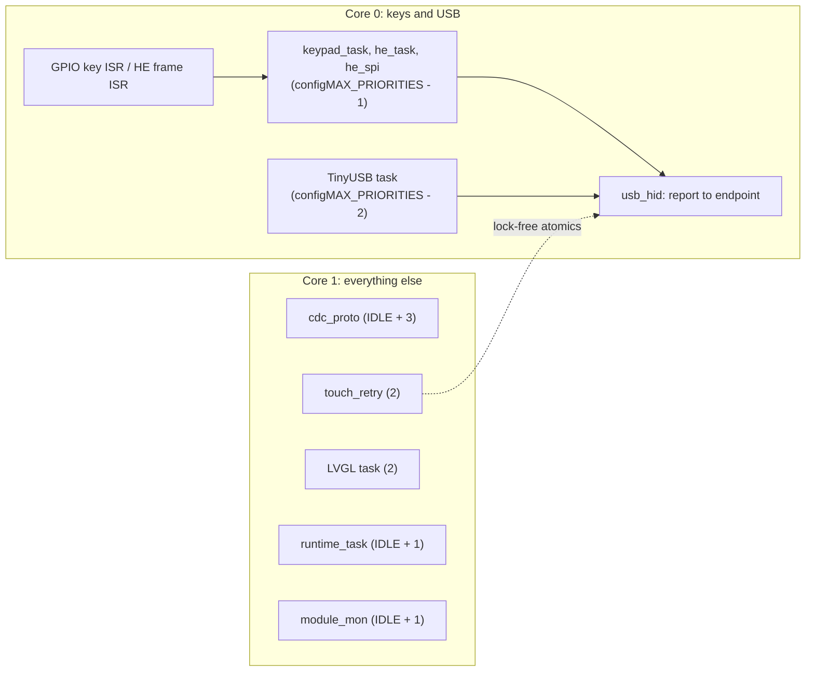
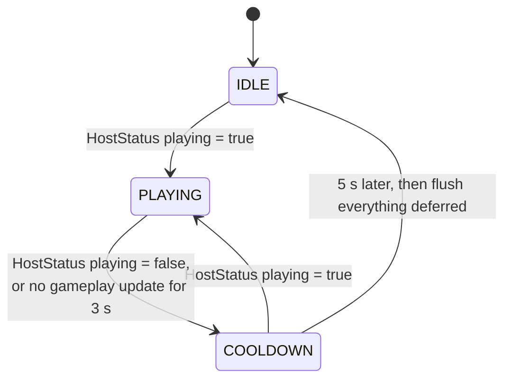

OPad is built around one rule: **latency always wins** ([AGENTS.md](https://github.com/OPad-dev/OPad/blob/main/AGENTS.md) §1.1). Everything else the pad does (the screen, the serial protocol, the touchscreen, flash storage) is arranged so that it cannot delay a key report. Three decisions carry most of that weight:

1. **Two cores, two jobs.** Core 0 runs the keys and USB; Core 1 runs everything else.
2. **No flash writes during a map.** A runtime state machine holds every NVS write until the map and a cooldown after it are over.
3. **One ordered channel to the pad.** The desktop daemon sends its commands one at a time, so they never race each other on the wire.

## Two cores, two jobs

The ESP32-S3 has two Xtensa LX7 cores, run at 240 MHz (`CONFIG_ESP_DEFAULT_CPU_FREQ_MHZ_240` in [sdkconfig.defaults](https://github.com/OPad-dev/OPad/blob/main/firmware/sdkconfig.defaults)). Rendering a screen or parsing a protobuf frame takes milliseconds; a key report must leave in microseconds. Putting them on different cores means the scheduler never has to choose between them.

<!-- src: /firmware/main/input/keypad.c#keypad_init, /firmware/main/input/he_backend.c#he_task, /firmware/main/input/he_spi_source.c#he_spi_source_start, /firmware/main/app_main.c#tusb_cfg, /firmware/main/usb/usb_cdc.c#usb_cdc_task, /firmware/main/input/touch_retry.c#touch_retry_init, /firmware/main/ui/ui_port.c#port_cfg, /firmware/main/runtime/runtime.c#runtime_init, /firmware/main/input/module_monitor.c -->

**Core 0** holds the keypress path and nothing else:

- The input tasks (`keypad_task` in [keypad.c](https://github.com/OPad-dev/OPad/blob/main/firmware/main/input/keypad.c) for switches, `he_task` in [he_backend.c](https://github.com/OPad-dev/OPad/blob/main/firmware/main/input/he_backend.c) and the V3 sampler `he_spi` in [he_spi_source.c](https://github.com/OPad-dev/OPad/blob/main/firmware/main/input/he_spi_source.c) for Hall Effect) run at `configMAX_PRIORITIES - 1`.
- The TinyUSB task runs one level below them (`tusb_cfg.task.priority = configMAX_PRIORITIES - 2`, `xCoreID = 0` in [app_main.c](https://github.com/OPad-dev/OPad/blob/main/firmware/main/app_main.c)), so only key input outranks USB.
- The path runs from IRAM. [linker.lf](https://github.com/OPad-dev/OPad/blob/main/firmware/main/linker.lf) places `keypad_task`, all of `usb_hid`, `he_frame`, `he_rt`, the V3 sampler and TinyUSB's HID and DWC2 hot paths in internal RAM. From flash, the key path shares the instruction cache with Core 1's screen work; the comment in `linker.lf` records a press taking ~240 µs to reach USB that way, against ~70 µs from IRAM.

**Core 1** runs the work that is allowed to be slow:

- `cdc_proto` ([usb_cdc.c](https://github.com/OPad-dev/OPad/blob/main/firmware/main/usb/usb_cdc.c), `tskIDLE_PRIORITY + 3`) decodes protocol frames from the host and sends replies.
- `touch_retry` ([touch_retry.c](https://github.com/OPad-dev/OPad/blob/main/firmware/main/input/touch_retry.c), priority 2) sleeps on the touch controller's interrupt and polls I2C only while a finger is down. See [Touchscreen as the Third Button](touchscreen-button.md).
- The LVGL task ([ui_port.c](https://github.com/OPad-dev/OPad/blob/main/firmware/main/ui/ui_port.c), `task_affinity = 1`, priority 2) draws 320×240 layouts to the ST7789 over SPI2 at 80 MHz (`BOARD_LCD_PIXEL_CLOCK_HZ`), at most every 33 ms (`CONFIG_LV_DEF_REFR_PERIOD=33`).
- `runtime_task` ([runtime.c](https://github.com/OPad-dev/OPad/blob/main/firmware/main/runtime/runtime.c), `tskIDLE_PRIORITY + 1`) runs the state machine below and does every deferred NVS write.

The cores meet in exactly one place: the touchscreen's Quick Retry key shares Key 1's HID report. That hand-off uses atomic sequence counters rather than a mutex (`hid_link_t` in [usb_hid.c](https://github.com/OPad-dev/OPad/blob/main/firmware/main/usb/usb_hid.c)), so a Core 1 task can never hold a lock the key path waits on. [Latency Engineering](latency.md#lockless-sequence-tracking-hid_link_t) explains how.

### Memory follows the same split

Internal RAM is scarce (it also holds the IRAM code above), so anything the key path never touches goes to the 8 MB of Octal PSRAM: LVGL's 160 KB pool (`CONFIG_OPAD_LVGL_PSRAM`, on by default in [Kconfig.projbuild](https://github.com/OPad-dev/OPad/blob/main/firmware/main/Kconfig.projbuild)) and protocol buffers marked `EXT_RAM_BSS_ATTR`. Internal RAM keeps the keys, USB, and the two 40-line DMA draw buffers (`UI_DRAW_BUF_LINES` in [ui.h](https://github.com/OPad-dev/OPad/blob/main/firmware/main/ui/ui.h)). The largest caches (32 KB instruction, 64 KB data) are a trade: `sdkconfig.defaults` records them halving frame time for 48 KB of internal RAM.

The trade-off of the whole design is that Core 1 work can be slow when Core 0 is busy, and a busy screen can drop frames. That is the intended direction: the screen gives way to the keys, never the other way round.

## No flash writes during a map

Writing NVS flash suspends the instruction cache on both cores for the duration of the erase or write. Anything not in IRAM stalls. Rather than prove every path safe during a write, the firmware refuses to write while a map is being played. [runtime.c](https://github.com/OPad-dev/OPad/blob/main/firmware/main/runtime/runtime.c) tracks three states:

- **`OPAD_STATE_IDLE`**: the only state in which NVS is written. Each 100 ms tick of `runtime_supervisor_task` flushes dirty config, layouts and Hall Effect calibration, and checkpoints counters when they are due.
- **`OPAD_STATE_PLAYING`**: entered when the host's `HostStatus` says a map is playing ([protocol.c](https://github.com/OPad-dev/OPad/blob/main/firmware/main/protocol/protocol.c) calls `runtime_notify_gameplay`). Writers check the state themselves and keep changes in RAM, marked dirty (for example `counters.c`, `device_config.c`, `ui_store.c` and `he_cal.c` all test `runtime_get_state() != OPAD_STATE_IDLE`).
- **`OPAD_STATE_COOLDOWN`**: 5 s after a map ends (`COOLDOWN_DURATION_US`). A quick retry starts a new map within seconds; without the cooldown, every retry would trigger a flush between attempts. A new map during the cooldown goes straight back to `PLAYING`.

The host's gameplay updates are also a heartbeat. If they stop for 3 s (`GAMEPLAY_TIMEOUT_US`), because the daemon or tosu died mid-map, the firmware leaves `PLAYING` by itself, so a crashed host cannot block storage forever. A restart the host asks for also waits for `IDLE` (`runtime_request_restart`).

The cost is that a change made during a map (a setting, a layout, the counters) lives only in RAM until the cooldown ends: unplugging the pad mid-map loses it.

## One ordered channel to the pad

`opad-daemon` ([runtime.rs](https://github.com/OPad-dev/OPad/blob/main/desktop/daemon/src/runtime.rs)) owns the USB CDC link, SQLite storage (`opad.db`), tosu supervision, updates, and the local IPC the GUI and `opadctl` use. Its runtime loop decides *what* to send; the device actor in [device_actor.rs](https://github.com/OPad-dev/OPad/blob/main/desktop/daemon/src/device_actor.rs) decides *when*.

Each `DeviceCommand` (`TimeSync`, `ClaimOwnership`, `Config`, `HostStatus`, `DataUpdate`, `Layout`, `RequestStatus`, `PlayAnimation`) is queued on one bounded channel (`QUEUE_DEPTH = 256`) and sent and awaited before the next one starts. The file's header records why: when each action was sent from its own task, a config and the layout after it could reach the pad in either order.

When the pad's input queue is full (`DeviceError::Busy`), a command is retried up to `BUSY_RETRIES = 5` times, `BUSY_BACKOFF = 20 ms` apart. A telemetry diff (`DataUpdate`) is not retried: by the next flush it is stale, so the actor sets `resend_data` and the runtime loop sends a full snapshot instead.

The daemon mirrors the pad's flash rule on its own storage. When a map starts it emits `SetStorageWritesAllowed(false)`, and `Storage` refuses writes (`StorageError::WritesBlocked` in [opad-storage](https://github.com/OPad-dev/OPad/blob/main/desktop/crates/opad-storage/src/lib.rs)) until its own cooldown ends and the post-map counter sync begins. Telemetry comes from tosu's WebSocket ([opad-tosu](https://github.com/OPad-dev/OPad/blob/main/desktop/crates/opad-tosu/src/lib.rs)) and is turned into rate-limited `DataUpdate` and `HostStatus` messages in [telemetry.rs](https://github.com/OPad-dev/OPad/blob/main/desktop/daemon/src/telemetry.rs).

For the module-by-module view, see [Firmware Subsystems](../develop/firmware/overview.md) and [Desktop Architecture](../develop/desktop/overview.md).
