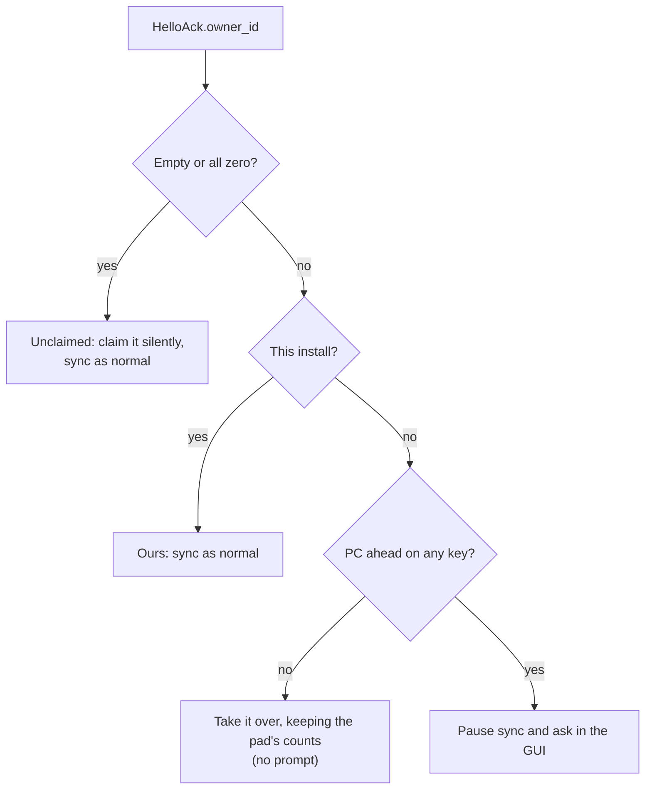

Lifetime key counts live in two places: on the pad (NVS flash) and on the PC (SQLite, `opad.db`). The pad has to count without a PC, since it is a keyboard first; the PC keeps history and backups. Two copies of a number can disagree, and the design question is how to merge them without ever losing presses or resurrecting counts the user deliberately reset.

Three ideas answer it: counts only go up within a **generation**, merges take the **maximum**, and a pad records which install **owns** it.

## Counting on the pad

[counters.c](https://github.com/OPad-dev/OPad/blob/main/firmware/main/counters/counters.c) and [key_event.c](https://github.com/OPad-dev/OPad/blob/main/firmware/main/input/key_event.c) keep one 64-bit lifetime count per key (Key 3 only on a three-key V3 module):

- **Counting is free.** An accepted press increments an atomic in RAM (`key_event_press_accepted`, called from the key path on Core 0). Nothing touches flash.
- **Saving is rare.** Counts reach NVS in a checkpoint, and `counters_checkpoint()` writes nothing unless the runtime state is `IDLE`, so never during a map or its cooldown. In `IDLE`, the runtime task checkpoints dirty counts once no key has been pressed for 30 s, or at least every 5 minutes while keys keep being pressed (`counters_checkpoint_due` in [counter_sync_rules.c](https://github.com/OPad-dev/OPad/blob/main/firmware/main/counters/counter_sync_rules.c)), and at once when the host suspends USB, when the host syncs, after a cooldown, and before a restart.

The trade-off: unplugging the pad can lose the presses since the last checkpoint. A PC that synced in between still has them, and the merge below gives them back.

## Merging: generations and maximum

Each side's state carries a `counter_generation` next to the counts. [`reconcile_counters()`](https://github.com/OPad-dev/OPad/blob/main/desktop/crates/opad-storage/src/lib.rs) merges them:

```rust
if pc.counter_generation > esp.counter_generation {
    pc.clone()          // a deliberate reset or restore on the PC wins
} else if esp.counter_generation > pc.counter_generation {
    esp.clone()
} else {
    // same generation: lifetime_key1/2 = max(pc, esp)
}
```

- **Same generation: take the maximum, key by key.** Counts only grow within a generation, so the larger number is always the more complete one. Presses made while the pad was unplugged from this PC are kept.
- **Higher generation wins outright.** Resetting counters (`opadctl reset --yes`, or **Reset lifetime counters** in the GUI) or restoring a backup raises the generation. That is the only way a *smaller* count can legitimately replace a larger one, and the generation makes the intent explicit instead of guessing.

The pad enforces the same rule: [counter_sync_rules.c](https://github.com/OPad-dev/OPad/blob/main/firmware/main/counters/counter_sync_rules.c) (`counters_validate_sync_acceptance`) refuses a sync from an older generation, or one that would lower a count within the same generation, unless the host forces it.

Reconciliation covers keys 1 and 2. Key 3 is counted and checkpointed on the pad, and the host writes it back only when restoring a backup (`send_counter_sync_key3` in [ipc_handlers.rs](https://github.com/OPad-dev/OPad/blob/main/desktop/daemon/src/ipc_handlers.rs)).

### Presses during a sync are not lost

A sync takes time on the wire, and the player may press a key while it is in flight. If the pad simply stored the host's number, those presses would vanish. Instead `counters_sync_from_host()` takes a snapshot, validates the sync against it, and then moves the live counters by the *difference* between the snapshot and the target (`rebase_lifetime_presses`, and `key_event_add_lifetime_key3(*k3 - current.lifetime_key3)` for Key 3). A press counted after the snapshot stays counted.

## Ownership: which PC a pad belongs to

The merge assumes both copies describe the same history. That breaks when a pad moves to another computer, or when OPad is reinstalled: the new install's database knows nothing of the pad's past, or holds a different pad's past. So the pad stores an owner ([identity.rs](https://github.com/OPad-dev/OPad/blob/main/desktop/daemon/src/identity.rs)):

- **Install ID.** A random UUIDv4 generated on the daemon's first run and stored in SQLite (`app_state`, key `install.id`). It identifies the *install*, not the machine: uninstalling removes `opad.db`, and a reinstall gets a new identity.
- **The pad's owner.** 16 bytes (`OWNER_ID_LEN`), written by `ClaimOwnership` and kept in the pad's NVS config. It is sent back in every `HelloAck.owner_id`. Nothing about it is cryptographic: it protects counter integrity, not exclusivity.

Ownership is decided in the same `HelloAck` that brings the counts, before anything is reconciled ([runtime.rs](https://github.com/OPad-dev/OPad/blob/main/desktop/daemon/src/runtime.rs), `ownership_of`):



- **Unclaimed** (empty or all zero, also what firmware older than ownership sends): the daemon writes its install ID to the pad (`ClaimOwnership`, an `IDLE`-only NVS write).
- **Ours:** normal reconciliation.
- **Someone else's, and the pad has at least this PC's presses on both keys** (`pc_is_ahead` is false): [`take_over_if_pad_is_ahead()`](https://github.com/OPad-dev/OPad/blob/main/desktop/daemon/src/ipc_handlers.rs) claims it and keeps the pad's counts. Moving a pad to a new PC, or reinstalling, needs no prompt.
- **Someone else's, and this PC is ahead on a key:** taking over automatically would throw presses away one way or the other, so the daemon sets `pending_takeover` and `foreign_pad`, stops syncing, and the GUI asks (`ResolveTakeover`): take over keeping the pad's counts, take over writing this PC's counts, or leave the pad alone. A pad left alone keeps working as a keyboard; the daemon just does not write to it.

The full set of connect-time cases, device replacement and backup restore are in [Recovery, Reflashing & Unbinding](../recovery.md); the firmware side is in [Counters (firmware)](../develop/firmware/counters.md).
