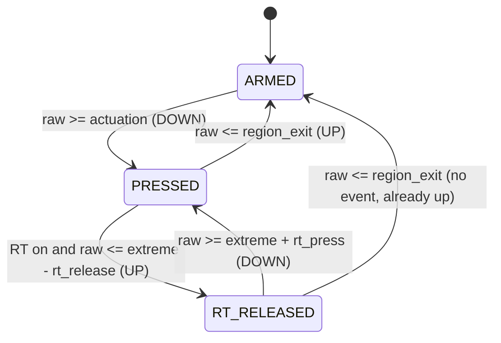

A Hall Effect (HE) switch has no contacts. A magnet in the stem moves over a linear Hall sensor, so the firmware reads *how far* the key is down, continuously, instead of *whether* a contact closed. That makes two things possible: an actuation point the user chooses, and **Rapid Trigger**, which releases a key as soon as it starts moving up and presses it again as soon as it moves down, wherever in the travel that happens.

It also moves the hard problems into firmware: reading an analog signal fast enough, telling movement from noise, and making sure a bad reading can never hold a key down.

## Two ways to read the sensors

[he_backend.c](https://github.com/OPad-dev/OPad/blob/main/firmware/main/input/he_backend.c) supports two module generations:

| | HE V1 (2 keys) | HE V3 (3 keys) |
|---|---|---|
| Source | ESP32-S3 ADC1 in continuous DMA mode (`HE_SOURCE_ESP_ADC`), sensors on GPIO10 and GPIO7 | TI ADS7028 12-bit ADC on the module, over SPI3 (`HE_SOURCE_ADS7028`) |
| Channels | Key 1 `ADC_CHANNEL_9`, Key 2 `ADC_CHANNEL_6` | Key 1 `AIN5`, Key 2 `AIN4`, Key 3 `AIN3`, auto-sequenced |
| Rate | 64 000 conversions/s (`HE_SAMPLE_HZ`), 16 per DMA frame: one frame every **250 µs** (4 kHz) | A `gptimer` alarm every `HE_SPI_FRAME_US = 50` µs: **20 kHz** |
| Per frame | Median of each key's valid conversions, in the frame interrupt (`on_frame`, IRAM) | 4 reads at 40 MHz (one stale from the last frame, then one per key), each with its CRC; a word with a bad CRC is dropped and that key keeps its last reading |
| Who decides | `on_frame` runs the decision engine and wakes `he_task` only when a key changes | The Core 0 `he_spi` task decodes the frame, runs the engine and reports a change itself (`publish()`), without a hand-off to `he_task` |
| Calibration sees | Every frame (4 kHz) | One frame in five (`HE_CAL_EVERY_V3 = 5`), the same 4 kHz |
| Calibration store | NVS namespace `opad_cal`, keys `cal_a` / `cal_b` | `opad_cal3`: `cal_a` / `cal_b` for keys 1–2, `cal3_a` / `cal3_b` for key 3 |

V1 sent analog voltages through the module cable to the ESP32's own ADC, which picked up noise on the way. V3 converts on the module and sends only digital SPI, with a CRC on every word ([hardware/pcb/V2/README.md](https://github.com/OPad-dev/OPad/blob/main/hardware/pcb/V2/README.md) records the noise that drove the change).

Two details keep the V3 path fast enough for 20 kHz. [he_spi_source.c](https://github.com/OPad-dev/OPad/blob/main/firmware/main/input/he_spi_source.c) sets SPI3 up once through the ESP-IDF driver and then starts each transfer directly on the `GPSPI3` registers (`ads7028_read16_again`), saving the driver's ~10 µs per word; the measurements are in [the ADS7028 notes](../hardware/components/ads7028.md). And a module cable plugged in upside down is detected at boot (`board_boot_cable_reversed()`), and `ads7028_carrier_pins()` swaps the SPI pins to match.

On V1, Kconfig selects `ADC_CONTINUOUS_ISR_IRAM_SAFE`, so the frame interrupt keeps running from IRAM even while flash is written.

## The Rapid Trigger engine

Each key is a small state machine in [he_rt.c](https://github.com/OPad-dev/OPad/blob/main/firmware/main/input/he_rt.c) (`he_rt_step`), fed one reading per frame. `raw` grows as the key goes down. `extreme` is the deepest point reached while pressed, or the shallowest point reached while rapid-trigger-released.

- **`HE_RT_ARMED`**: released, waiting for a first press at the actuation point. After boot, a settings change or a fault (`need_release`), the key must first be seen back above the release threshold before it may press at all.
- **`HE_RT_PRESSED`**: held. Without Rapid Trigger it is released at the fixed release threshold, below actuation, which gives hysteresis. With Rapid Trigger, `extreme` follows the key down and the key is released as soon as it rises `rt_release` above that point.
- **`HE_RT_RT_RELEASED`**: released mid-stroke. `extreme` now follows the key *up*, and as soon as it goes down `rt_press` again, it is pressed, without returning to the actuation point.

`region_exit()` is where Rapid Trigger's region ends. In **Normal** mode it is the release threshold: come up past it and the next press needs a full crossing of actuation again. In **Continuous** mode it is `top_reset`, near the top of travel, so Rapid Trigger stays active almost all the way to rest.

`extreme` is capped at `peak_cap` (`cap_peak()`), the optional **bottom dead zone**: pressing harder into the switch's bottom damper does not move the point the key has to come back up from.

New thresholds never change a key mid-press. `he_rt_set_params()` keeps them pending until the key is up.

## Percent of a calibrated span, with noise floors

Magnet strength and sensor response vary from switch to switch and are not linear in travel, so a setting in millimetres would mean something different on every key. Settings are instead stored in 0.1 % of each key's calibrated magnetic span, `full - rest` (`HE_PCT_FULL = 1000` in [he_params.h](https://github.com/OPad-dev/OPad/blob/main/firmware/main/input/he_params.h)); [v2-hall-effect-decisions.md](../specs/v2-hall-effect-decisions.md) D3 records the decision.

A percentage can ask for less movement than the sensor's noise. `he_params_build()` therefore raises movement thresholds (`rt_press`, `rt_release`, the release hysteresis) and the top-reset clearance to measured noise floors, and **says so**: each raised value sets a `HE_PARAMS_*_RAISED` flag the app shows, never a silent change. **Allow below the noise floor** (`no_floor`) lowers the floors to 1 count for users who want to accept the risk of phantom presses.

## Calibration

The guided calibration ([he_cal_capture.h](https://github.com/OPad-dev/OPad/blob/main/firmware/main/input/he_cal_capture.h), [he_cal_runner.c](https://github.com/OPad-dev/OPad/blob/main/firmware/main/input/he_cal_runner.c)) measures the two ends of the span:

- **Rest**: after 64 frames to settle, the average of 64 frames (16 ms at 4 kHz), checked for spread and absolute bounds.
- **Full press**: five full strokes per key; the **median** peak is used, so one unusually hard bottom-out does not stretch the span. A key that released below its measured rest fails (`HE_CAL_ERR_REST_PRESSED`).

[he_cal.c](https://github.com/OPad-dev/OPad/blob/main/firmware/main/input/he_cal.c) keeps two copies (A/B) with sequence numbers and a CRC-32, writing the older one, so a write cut short by unplugging leaves the other intact. V1 and V3 use separate namespaces so one generation's calibration never drives the other. Like every NVS write, saving waits for `IDLE`. The user procedure is [Calibrating Hall Effect](../guides/calibrate-hall-effect.md).

## A fault can never hold a key down

- **Uncalibrated lockout (D7).** Until every active key has a valid calibration (`he_cal_is_locked_decision`), `he_cal_suppress_input` suppresses all key output, the screen is locked to the calibration screen, touch only operates its button and swipes are off ([he_cal_ui.c](https://github.com/OPad-dev/OPad/blob/main/firmware/main/ui/he_cal_ui.c)).
- **Stalls.** `he_task` checks health regularly ([he_health.c](https://github.com/OPad-dev/OPad/blob/main/firmware/main/input/he_health.c)): a key with no valid reading for `HE_STALL_US` (5 ms) is released and ignored until readings return; no frames at all for that long releases every key and restarts the source, with a growing back-off.
- **Recovery never presses.** A key released this way goes through `he_rt_fault()`, which sets `need_release`: when readings come back, the key must be seen up before it can press again.
- **Pausing the source.** Work that needs the ADC or SPI3 to itself goes through `he_backend_run_paused()`, which releases the keys first and resumes the stream afterwards: on V1, `he_backend_probe_module` pausing ADC1 to read the module ID once both keys read absent; on V3, the board test's ADC checks (`he_adc_test_run`).

How these pieces fit into the firmware is in [Input (firmware)](../develop/firmware/input.md).
