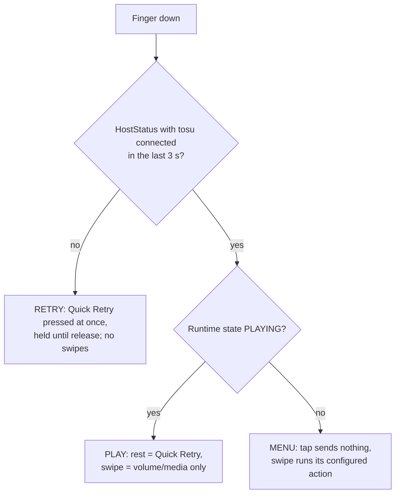

The touchscreen is the pad's **third button** ([AGENTS.md](https://github.com/OPad-dev/OPad/blob/main/AGENTS.md) §1.4). During a map, a resting finger holds osu!'s Quick Retry key (`` ` ``) for as long as it stays down, because osu!'s retry is itself a hold. Outside a map the same surface becomes four swipe actions. Doing both on one surface, cheaply and without ever confusing the two, is what [touch_retry.c](https://github.com/OPad-dev/OPad/blob/main/firmware/main/input/touch_retry.c) is about.

For the user-facing behaviour and settings, see [Touchscreen and Swipes](../guides/touchscreen-and-swipes.md).

## Cheap when idle

The CST816 controller sits on I2C (`CST816_I2C_ADDR = 0x15`, 100 kHz, `I2C_NUM_0`) on GPIO 48 (SDA) and GPIO 47 (SCL), with an active-low interrupt on GPIO 46 ([board_pins.h](https://github.com/OPad-dev/OPad/blob/main/firmware/boards/waveshare_esp32s3_touch_lcd_2/board_pins.h)). Its task runs on Core 1 at priority 2, away from the keys.

- **No finger: no work.** `touch_retry_task` blocks in `ulTaskNotifyTake()` until the interrupt (`touch_int_isr`) fires. It also wakes once a second (`TOUCH_IDLE_CHECK_MS = 1000`) as a safety net for a silent INT line; if the interrupt cannot be set up at all, it falls back to polling at 100 Hz.
- **Finger down: 100 Hz polling.** While touched, the task reads the controller every `TOUCH_POLL_MS = 10` ms. INT may pulse once per report rather than stay low, so the touch count, not the pin, is what keeps the button held.
- **A clean release.** The button is released only after `TOUCH_RELEASE_READS = 2` empty reads in a row (~20 ms), so one bad read does not end a hold.

The panel is portrait (240×320) and the UI is drawn landscape, so coordinates are swapped and mirrored (`TOUCH_SWAP_XY`, `TOUCH_MIRROR_Y`) to make "up" mean up as the pad is held.

## Three modes, chosen at touch-down

What a touch does depends on whether the pad knows a map is being played. `touch_mode_now()` decides once, when the finger lands:

| Mode | When | A touch | A swipe |
|---|---|---|---|
| `TOUCH_MODE_RETRY` | No `HostStatus` with tosu connected in the last 3 s (`HOST_STATUS_TIMEOUT_US`): no daemon, no tosu, or a host that went quiet. | Quick Retry, pressed at touch-down and held until release. | Disabled. |
| `TOUCH_MODE_PLAY` | Host recently seen with tosu, and the runtime state is `PLAYING`. | Quick Retry once the finger rests (below). | Volume and media actions only; never a keyboard key. |
| `TOUCH_MODE_MENU` | Host recently seen with tosu, and not `PLAYING`. | Nothing. | The configured action. |

`RETRY` is the fallback on purpose: without a host the pad cannot tell a map from a menu, and the one thing a touch must never fail to do is retry.

### Telling a rest from a swipe during a map

In `PLAY` mode the pad must not send Quick Retry for a finger that is about to swipe (a retry restarts the map). So it waits, briefly, to see which one it is ([`touch_retry_task()`](https://github.com/OPad-dev/OPad/blob/main/firmware/main/input/touch_retry.c)):

- If the finger stays within `PLAY_RETRY_STILL_PX = 12` px of where it landed (Chebyshev distance, [`gesture_distance()`](https://github.com/OPad-dev/OPad/blob/main/firmware/main/input/gesture.c)) for `PLAY_RETRY_STILL_US = 60` ms, it is resting: Quick Retry is pressed and held.
- A finger still down after `PLAY_SWIPE_WINDOW_US = 250` ms without having become a swipe is a hold all the same.
- A finger lifted before either, without a swipe, sends a short press and release (`tap_retry()`).
- Once a swipe fires, that touch never sends Quick Retry.

The 60 ms wait costs nothing noticeable, because osu! only retries after the key has been held for a while anyway.

## Swipes

Motion is classified in [gesture.c](https://github.com/OPad-dev/OPad/blob/main/firmware/main/input/gesture.c):

- **Axis lock.** A finger has to move `GESTURE_SWIPE_PX = 30` px, with one axis clearly leading (at least 1.5 : 1, `2·|dy| >= 3·|dx|` for vertical), before a direction is chosen. A diagonal waits for more movement.
- **Vertical repeats, horizontal fires once.** A vertical drag steps once per 30 px and can turn back, so one long drag steps the volume several times. A horizontal swipe fires once per touch. Only volume actions repeat; any other action fires on the first step only.

Each direction's action comes from the device config. The defaults ([touch_retry.c](https://github.com/OPad-dev/OPad/blob/main/firmware/main/input/touch_retry.c), [opad-model](https://github.com/OPad-dev/OPad/blob/main/desktop/crates/opad-model/src/lib.rs)) are:

- **Up / down: volume.** When the host reports `HostStatus.osu_active` ([osu_window.rs](https://github.com/OPad-dev/OPad/blob/main/desktop/daemon/src/osu_window.rs): osu! is the foreground window on Windows, osu!lazer is running on Linux), the pad changes *osu!'s* volume with the mouse wheel (`usb_media_wheel`): Alt + wheel in menus, where a plain wheel scrolls song select, and the plain wheel during a map. Otherwise it sends the system Volume Up / Down consumer keys (`usb_media_consumer_tap`).
- **Left / right: previous / next track** (consumer keys).

In menus, [`step_volume()`](https://github.com/OPad-dev/OPad/blob/main/firmware/main/input/touch_retry.c) holds Left Alt across every notch of one drag. Windows reads an Alt press and release with nothing in between as "open the window menu" (`SC_KEYMENU`), which can make a game drop the next key, so before letting Alt go [`release_alt()`](https://github.com/OPad-dev/OPad/blob/main/firmware/main/input/touch_retry.c) taps F24 (`HID_KEY_F24`, a key nothing uses), waiting up to `TOUCH_KEY_WAIT_MS = 30` ms for each report to be delivered.

## What never happens during a map

1. **No Alt, no extra keys.** In `PLAY` mode the volume swipe uses the plain wheel, and [`run_swipe_action()`](https://github.com/OPad-dev/OPad/blob/main/firmware/main/input/touch_retry.c) refuses `SWIPE_ACTION_KEY`. Key 1's keyboard report only ever carries the game keys and Quick Retry.
2. **Nothing extra on screen.** [`handle_swipe()`](https://github.com/OPad-dev/OPad/blob/main/firmware/main/input/touch_retry.c) shows the swipe feedback (`ui_show_swipe()`) only outside a map.
3. **An uncalibrated Hall Effect pad is the exception.** While `he_cal_suppress_input()` is true (decision D7 in [v2-hall-effect-decisions.md](../specs/v2-hall-effect-decisions.md)), every touch goes to the calibration screen's button (`he_cal_ui_touch_sample`), swipes are off and no key is sent. A lock that starts while a finger is already down releases Quick Retry and any held Alt at once.

How the touch key shares Key 1's report with the switch on Core 0, without a lock, is in [Latency Engineering](latency.md#lockless-sequence-tracking-hid_link_t). The task's internals are in [Touch (firmware)](../develop/firmware/touch.md).
