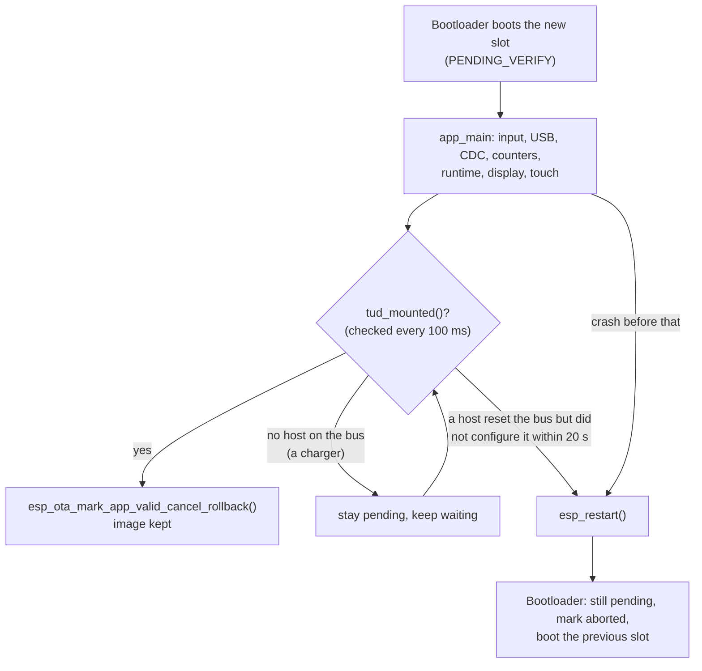
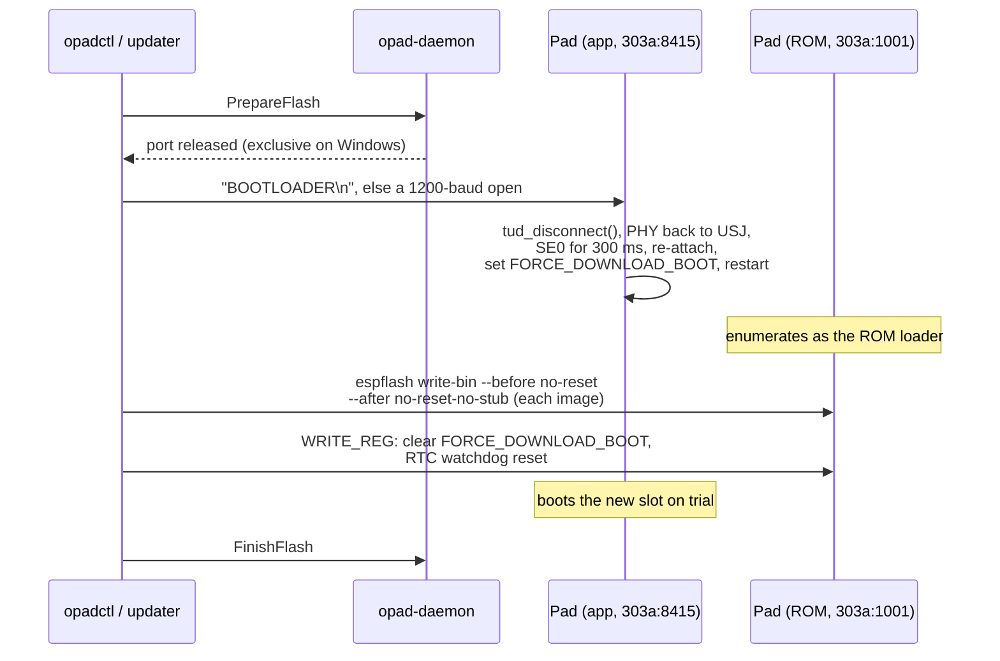

A pad is updated, flashed and recovered over USB only. Nobody is ever asked to press BOOT or RESET ([AGENTS.md](https://github.com/OPad-dev/OPad/blob/main/AGENTS.md) §1.5). That rules out the usual safety net for a bad flash, so the firmware has to provide its own: **an update must not be able to strand a pad.** Two layers make sure it cannot:

1. **Two app slots with a trial boot.** A new image goes into the slot the pad is *not* running, boots once on trial, and is kept only if a host configures its USB. Otherwise the bootloader goes back to the old one by itself.
2. **The ROM bootloader as a last resort.** A pad whose app never enumerates is caught by `opadctl recover` during its next boot, in the mask ROM's USB loader, which no flash content can break.

<!-- src: /firmware/main/app_main.c#confirm_image_once_usb_works, /desktop/crates/opad-device/src/flash.rs#recover -->

## Two slots

[partitions.csv](https://github.com/OPad-dev/OPad/blob/main/firmware/partitions.csv) has two 2 MB app slots, and the bootloader is built with rollback support (`CONFIG_BOOTLOADER_APP_ROLLBACK_ENABLE=y` in [sdkconfig.defaults](https://github.com/OPad-dev/OPad/blob/main/firmware/sdkconfig.defaults)):

| Partition | Type | Offset | Size | Holds |
|---|---|---|---|---|
| `nvs` | data, nvs | `0x9000` | 24 KB | Settings, owner, calibration, layouts, lifetime counters |
| `otadata` | data, ota | `0xf000` | 8 KB | Which slot boots, and its state (two 4 KB sectors) |
| `phy_init` | data, phy | `0x11000` | 4 KB | RF calibration data |
| `ota_0` | app | `0x20000` | 2 MB | App slot 0 (`APP_PARTITION_OFFSET` in [flash.rs](https://github.com/OPad-dev/OPad/blob/main/desktop/crates/opad-device/src/flash.rs)) |
| `ota_1` | app | `0x220000` | 2 MB | App slot 1 (`OTA_1_OFFSET`) |

`nvs` stayed at its original offset and size when the slots were added: moving it would have lost every pad's counters and owner.

The host plans an update with [`plan_app_update()`](https://github.com/OPad-dev/OPad/blob/main/desktop/crates/opad-device/src/flash.rs):

1. The pad reports the slot it booted from in `HelloAck.running_partition`.
2. The new image goes to the **other** slot (`ota_1` when running `ota_0`, and the reverse), so the working image is never touched. A pad that ran one update from `ota_1` takes the next into `ota_0` ([`is_ota_slot()`](https://github.com/OPad-dev/OPad/blob/main/desktop/crates/opad-update/src/firmware.rs)).
3. [`otadata_image()`](https://github.com/OPad-dev/OPad/blob/main/desktop/crates/opad-device/src/flash.rs) builds a fresh `otadata`: sector 0 keeps the old slot as `OTA_IMG_VALID`, sector 1 selects the new slot with a higher sequence number as `OTA_IMG_NEW`. Each entry carries the CRC-32 the bootloader checks (`otadata_crc`).
4. The app image is written first and `otadata` second, so an interrupted write leaves the old slot selected and the old image boots.

Two cases fall outside this. A pad that reports no OTA slot (firmware too old to say, or the pre-OTA `factory` layout) cannot take an update from the app's updater, which reports `NeedsFullReflash` and asks for a one-time `opadctl flash --full`. And `opadctl flash` with no daemon running cannot learn the running slot, so it says so, writes `ota_0` and blanks the boot selection so that `ota_0` is what boots, with no fallback.

## The trial boot

The bootloader boots an `OTA_IMG_NEW` slot once and marks it `ESP_OTA_IMG_PENDING_VERIFY`. From then on, the image has to confirm itself; an image still pending at the next reset is marked aborted and the previous `VALID` slot boots.

What counts as "working" is the important decision. Booting is not enough: an image that boots, runs its tasks and never becomes a USB keyboard is exactly the image that would strand a pad. So [`confirm_image_once_usb_works()`](https://github.com/OPad-dev/OPad/blob/main/firmware/main/app_main.c), the last thing `app_main` does, confirms only once a **host has configured USB**:

- The 20 s window (`IMAGE_CONFIRM_TIMEOUT_US`) starts when a host attaches (`tud_connected()`), not at boot.
- On a charger or power bank no host ever attaches, so the image is neither confirmed nor rolled back: it stays pending until it is next plugged into a computer. A pad used away from a PC is never rolled back for lack of one.
- A crash loop rolls back the same way, since each crash is a reset of an unconfirmed image.
- A restart the host asks for waits until the image is confirmed (`image_confirmed()` in [runtime.c](https://github.com/OPad-dev/OPad/blob/main/firmware/main/runtime/runtime.c)); otherwise the restart itself would roll it back.

## Getting into the bootloader over USB

The app owns the USB PHY with TinyUSB; the ROM loader that `espflash` talks to uses the chip's built-in USB-Serial-JTAG. Moving from one to the other without a button is a handshake between the daemon, the firmware and the flasher ([`enter_bootloader()`](https://github.com/OPad-dev/OPad/blob/main/desktop/crates/opad-device/src/flash.rs), [`reboot_to_rom_download()`](https://github.com/OPad-dev/OPad/blob/main/firmware/main/usb/usb_cdc.c)):

1. The daemon holds the pad's serial port, so `opadctl flash` first asks it to let go (`IpcRequest::PrepareFlash`; the updater calls `pause_and_release()`). On Windows a serial handle is exclusive, so this is required.
2. `enter_bootloader()` tries two triggers in turn (`BOOT_TRIGGERS`): the text command `BOOTLOADER\n` on the CDC port, then opening the port at 1200 baud.
3. The firmware flushes CDC, calls `tud_disconnect()`, hands the PHY back to USB-Serial-JTAG, and holds SE0 (both lines pulled down) for 300 ms so the host sees a real detach. It re-attaches, restoring the D+ pull-up *before* dropping the pull override, waits up to 1.5 s for the host's bus reset, sets `RTC_CNTL_FORCE_DOWNLOAD_BOOT` and restarts into the ROM loader. Each of those details fixed a real failure; [AGENTS.md](https://github.com/OPad-dev/OPad/blob/main/AGENTS.md) §6 lists them.
4. [`write_images()`](https://github.com/OPad-dev/OPad/blob/main/desktop/crates/opad-device/src/flash.rs) runs `espflash write-bin --chip esp32s3 --before no-reset --after no-reset-no-stub --non-interactive` once per image, staying in the flasher stub between them.
5. [`reset_to_app()`](https://github.com/OPad-dev/OPad/blob/main/desktop/crates/opad-device/src/flash.rs) leaves download mode itself: it sends SLIP `WRITE_REG` commands that clear `FORCE_DOWNLOAD_BOOT` and trigger an RTC watchdog reset. espflash cannot do this on the S3: its own `--after watchdog-reset` is a silent no-op there, and it refuses to reset a chip with that bit set.
6. The daemon resumes (`IpcRequest::FinishFlash`) and waits for the pad to come back.

If the new app never enumerates, the trial boot rolls it back. If even that cannot happen (the bootloader or the partition table itself is broken), `opadctl recover` waits for the pad's next boot, catches it in the ROM loader as it appears, holds it in download mode and writes the full image set. The procedure is in [Recovery](../recovery.md) §7.6–7.7.

## App and tosu updates

App, bundled tosu and firmware offers come from one signed feed, read by [opad-update](https://github.com/OPad-dev/OPad/blob/main/desktop/crates/opad-update/src/lib.rs) and the daemon's update worker ([updater.rs](https://github.com/OPad-dev/OPad/blob/main/desktop/daemon/src/updater.rs)). How the feed is built and published is in [Release Pipelines](../develop/releases.md).

- **Nothing changes during a map.** Every updater asks [`may_update_now()`](https://github.com/OPad-dev/OPad/blob/main/desktop/crates/opad-update/src/gate.rs) first, which allows `Idle` only: replacing a binary or flashing mid-map is the same hazard as writing flash mid-map, with more force.
- **Schedule and channel.** The worker wakes every 15 minutes (`TICK`) and checks the feed once a day ([schedule.rs](https://github.com/OPad-dev/OPad/blob/main/desktop/crates/opad-update/src/schedule.rs)), backing off after failures. Users pick `stable` (default) or `beta` under **Settings → Updates & Firmware**. Staged rollouts are bucketed by install ID (`rollout::for_install`).
- **Verified before use.** The feed's bytes are checked against a minisign signature and the compiled-in key before they are parsed; the public test key is trusted only with `OPAD_TRUST_TEST_KEY=1` (or, for the root update helper, the root-owned `/etc/opad/trust-test-key`). Every downloaded file must match the SHA-256 the signed feed gives for it ([verify.rs](https://github.com/OPad-dev/OPad/blob/main/desktop/crates/opad-update/src/verify.rs)), and is written to a temporary file and renamed into place, so a half-written binary is never installed.
- **Applied the way the install was made.** The `install-origin` marker picks the method ([origin.rs](https://github.com/OPad-dev/OPad/blob/main/desktop/crates/opad-update/src/origin.rs)); the per-package table is in [Packaging](../develop/packaging.md).
  - `windows`: the new Inno Setup installer with `/SILENT /NORESTART /RELAUNCH=1` ([`apply_command()`](https://github.com/OPad-dev/OPad/blob/main/desktop/crates/opad-update/src/app.rs)). An automatic update stages it (`STAGED_KEY`) and runs it at the next start; **Install now** runs it at once.
  - `deb`, `rpm`, `aur`: `pkexec /usr/lib/opad/opad-update-helper`, which a polkit action lets the user at the computer run without a password. Because that makes the helper a door into root, it installs only a newer OPad release the signed feed names, checking the signature, the package's SHA-256 and the version itself before calling `apt-get`, `dnf` or `pacman -U` ([helper.rs](https://github.com/OPad-dev/OPad/blob/main/desktop/crates/opad-update/src/helper.rs)).
  - `appimage`, `user`: the AppImage file is replaced atomically, or the archive is extracted over the install prefix.
  - `source`, or a missing or unknown marker: notify only; nothing is modified.
- **Never a surprise restart.** With **Install OPad updates automatically** on (the default), an app update is installed while no map is played but the running OPad is not restarted: the GUI shows "OPad *version* is installed and runs the next time OPad starts." (on Windows, "…is ready and installs the next time OPad starts."). Bundled tosu updates itself only where OPad owns the binary (`windows`, `user`, `appimage`).
- **Firmware waits for an idle pad.** With **Install firmware updates automatically** on (the default), the daemon flashes a new firmware once the pad has gone 30 minutes unused (`AUTO_IDLE` in [firmware_update.rs](https://github.com/OPad-dev/OPad/blob/main/desktop/daemon/src/firmware_update.rs)); **Update now** still asks first.
