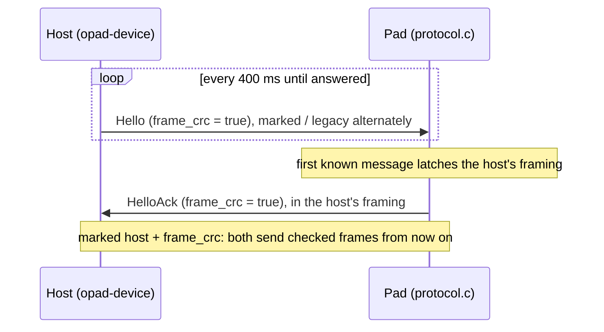

The daemon talks to the pad over its USB CDC-ACM serial port (opened at 115200 baud). Every message is a Protocol Buffers v3 envelope, `HostToDevice` or `DeviceToHost`, from `protocol/opad.proto`, inside a length-prefixed frame. The pad encodes with nanopb, the host with prost.
<!-- src: /protocol/opad.proto, /desktop/crates/opad-protocol/src/lib.rs, /desktop/crates/opad-device/src/lib.rs, /firmware/main/protocol/protocol.c -->

The app and the pad update independently, so both ends speak every framing and old/new combinations keep working (see [App and Pad Versions](../explanation/app-and-pad-versions.md)).
<!-- src: /desktop/crates/opad-protocol/src/lib.rs#Framing -->

## Framing

All three framings have a 4-byte header.
<!-- src: /firmware/main/protocol/frame_parser.h, /desktop/crates/opad-protocol/src/lib.rs#Framing -->

| Framing | Layout | Used |
|---|---|---|
| Legacy | `[len u32 LE][payload]` | Apps and firmware from before the marker |
| Marked | `[0xAA 0x55][len u16 LE][payload]` | Default |
| Checked | `[0xAA 0x5A][len u16 LE][payload][CRC-16 LE]` | Once both ends agreed in the handshake |
<!-- src: /firmware/main/protocol/frame_parser.h#FRAME_MAGIC_0, /desktop/crates/opad-protocol/src/lib.rs#FRAME_MAGIC, /desktop/crates/opad-protocol/src/lib.rs#FRAME_MAGIC_CHECKED -->

The framings cannot be confused: a legacy header that starts `AA 55` or `AA 5A` would claim at least `0x55AA` bytes, more than any frame may hold.
<!-- src: /firmware/main/protocol/frame_parser.h -->

### Limits

| Limit | Value | Source |
|---|---|---|
| Header | 4 bytes | `HEADER_BYTES`, `FRAME_HEADER_SIZE` |
| CRC trailer (checked only) | 2 bytes | `CRC_BYTES`, `FRAME_CRC_SIZE` |
| Largest payload | 8186 bytes (8192 − 4 − 2) | `MAX_PAYLOAD_BYTES`, `FRAME_MAX_PAYLOAD` |
| Smallest legacy payload | 2 bytes, so runs of zero bytes never read as empty frames | `LEGACY_MIN_PAYLOAD`, `FRAME_LEGACY_MIN_PAYLOAD` |
| Largest frame the pad sends | 1024 bytes including header and CRC, so a frame always fits the CDC TX FIFO whole | `send_envelope` |
| Stale partial frame | Dropped after 500 ms without bytes | `RX_STALE_US`, `STALE_PARTIAL_FRAME` |
<!-- src: /desktop/crates/opad-protocol/src/lib.rs#MAX_PAYLOAD_BYTES, /firmware/main/protocol/frame_parser.h#FRAME_MAX_PAYLOAD, /firmware/main/protocol/protocol.c#send_envelope, /firmware/main/protocol/protocol.c#RX_STALE_US, /desktop/crates/opad-device/src/lib.rs#STALE_PARTIAL_FRAME -->

### CRC-16

Checked frames carry CRC-16/CCITT-FALSE over the two length bytes and the payload (not the marker), so a damaged length fails too. It is appended little-endian.
<!-- src: /firmware/main/protocol/frame_parser.c#checked_crc, /desktop/crates/opad-protocol/src/lib.rs#checked_crc -->

| Parameter | Value |
|---|---|
| Polynomial | `0x1021` |
| Initial value | `0xFFFF` |
| RefIn / RefOut | `false` / `false` |
| XorOut | `0x0000` |
| Check (`"123456789"`) | `0x29B1` |
<!-- src: /firmware/main/protocol/frame_parser.c#frame_crc16, /desktop/crates/opad-protocol/src/lib.rs#crc16 -->

### Resynchronisation

Both parsers slide past bytes that cannot start a frame:

- A marker whose length exceeds 8186 is not a header: skip one byte.
- A checked frame with a bad CRC, or a payload that does not decode, is dropped by its first byte only, so a real frame glued behind a truncated one is still found.
- Once the framing is known the parser is locked to it. Locked to marked, it jumps straight to the next `0xAA`; locked to legacy, a header is believed only when its top two length bytes are zero.
- The pad drops a stale partial frame after 500 ms. A checked partial is dropped by one byte so whole frames behind it still arrive.
<!-- src: /firmware/main/protocol/frame_parser.c#scan, /firmware/main/protocol/frame_parser.c#frame_parser_expire, /desktop/crates/opad-protocol/src/lib.rs#resync, /desktop/crates/opad-protocol/src/lib.rs#decode_frame -->

## Handshake and framing negotiation

1. While the pad's framing is unknown, the host sends `Hello` every 400 ms (`HELLO_RETRY`), alternating marked and legacy framing. `Hello` carries `protocol_version = 1`, `he_calibration = true`, `frame_crc = true` and `config_revision = 1` (`CONFIG_REVISION`: the newest set of setting values the app knows; the pad keeps any setting whose stored value is newer, whatever the app sends for it).
2. The pad sends nothing until it has decoded a message it recognises. The framing of that frame becomes the host's framing for the connection (a checked frame counts as marked), and the parser is locked to it.
3. The pad answers `Hello` with `HelloAck` in that framing. `HelloAck.frame_crc` is true when the `Hello` asked for checked frames and the framing is marked; the `HelloAck` itself is still a marked frame, and every frame after it is checked.
4. On `HelloAck.frame_crc = true` the host also sends checked frames. Firmware that predates `frame_crc` ignores the field, and both ends stay on marked frames.
5. After 10 unanswered `Hello`s (`HELLOS_BEFORE_REOPEN`) the host closes and reopens the port. Closing the port drops DTR, and the pad then forgets the framing and the CRC agreement.
<!-- src: /desktop/crates/opad-device/src/lib.rs#Handshake, /desktop/crates/opad-device/src/lib.rs#hello_framing, /desktop/crates/opad-device/src/lib.rs#hello_message, /firmware/main/protocol/protocol.c#on_frame_received, /firmware/main/protocol/protocol.c#handle_host_message, /firmware/main/protocol/protocol.c#protocol_reset_rx -->

A host that reads a `HelloAck.protocol_version` other than `1` (`DEVICE_PROTOCOL_VERSION`) leaves the pad alone and reports it as incompatible.
<!-- src: /desktop/crates/opad-protocol/src/lib.rs#DEVICE_PROTOCOL_VERSION -->

### Capability flags

New features are announced in `HelloAck` instead of by version number. Firmware that predates a flag sends its default (`false` / `0`), and the host then does without the feature.
<!-- src: /protocol/opad.proto#HelloAck -->

| `HelloAck` field | Meaning when set |
|---|---|
| `key_press_times` | The pad sends `KeyPressBatch` during a map; otherwise the host measures the tap rate from tosu. |
| `board_test` | The pad answers `run_board_test`. |
| `builtin_animations` | Highest built-in result animation id; `0` = no `PlayAnimation`. |
| `restart` | The pad honours `restart`. |
| `he_input` | Firmware built with the Hall Effect backend (says nothing about the module plugged in). |
| `he_calibration` | An active Hall Effect backend with interactive calibration. |
| `he_live` | The pad streams `HeLiveSample` on `he_live_view`. |
| `tap_rate_per_second` | The pad shows tap-rate widgets flagged `UI_FLAG_PER_SECOND` in keys per second. |
| `key_count` | Keys the pad reads: `3` with a Hall Effect V3 module, else `2`; `0` reads as `2`. |
| `input_module` | The module found at boot (`InputModule`); `UNKNOWN` from older firmware. |
| `frame_crc` | The pad switched to checked frames. |
| `ota_chunk_max` | The pad takes a new app image over this connection, in pieces of up to this many bytes (4096); `0` = it is flashed through the ROM bootloader. |
<!-- src: /protocol/opad.proto#HelloAck -->

## Envelopes

Both envelopes carry a `sequence_number` and one `payload`:
<!-- src: /protocol/opad.proto#HostToDevice, /protocol/opad.proto#DeviceToHost -->

| Tag | `HostToDevice.payload` |
|---|---|
| 2 | `Hello hello` |
| 3 | `SetConfig set_config` |
| 4 | `TimeSync time_sync` |
| 5 | `GameplayDisplayState gameplay_state` |
| 6 | `CounterSyncRequest counter_sync` |
| 7 | `bool request_status` |
| 8 | `HostStatus host_status` |
| 9 | `bool reset_latency_stats` |
| 10 | `DataUpdate data_update` |
| 11 | `SetLayout set_layout` |
| 12 | `uint32 reset_layout` |
| 13 | `bool request_logs` |
| 14 | `ClaimOwnership claim_ownership` |
| 15 | `DetectPinRequest detect_pin` |
| 16 | `bool run_board_test` |
| 17 | `PlayAnimation play_animation` |
| 18 | `bool restart` |
| 19 | `bool start_he_calibration` |
| 20 | `bool cancel_he_calibration` |
| 21 | `bool he_live_view` |
| 22 | `OtaBegin ota_begin` |
| 23 | `OtaChunk ota_chunk` |
| 24 | `OtaEnd ota_end` |
| 25 | `bool ota_abort` |

| Tag | `DeviceToHost.payload` |
|---|---|
| 2 | `HelloAck hello_ack` |
| 3 | `DeviceStatus status` |
| 4 | `ConfigAck config_ack` |
| 5 | `CounterSyncResponse counter_sync_resp` |
| 6 | `LogEventBatch log_batch` |
| 7 | `LayoutAck layout_ack` |
| 8 | `DetectPinResponse detect_pin_resp` |
| 9 | `KeyPressBatch key_presses` |
| 10 | `BoardTestResult board_test` |
| 11 | `HeCalibrationProgress he_calibration_progress` |
| 12 | `HeLiveSample he_live_sample` |
| 13 | `OtaStatus ota_status` |
<!-- src: /protocol/opad.proto#HostToDevice, /protocol/opad.proto#DeviceToHost -->

## Message catalogue

### Session and status

| Message | Direction | Purpose |
|---|---|---|
| `Hello` / `HelloAck` | host → pad / pad → host | Handshake. `HelloAck` also carries `firmware_version`, `board_profile`, `device_id`, `counter_generation`, key 1/2 lifetime totals, the 16-byte `owner_id`, `running_partition` (`ota_0`, `ota_1`, `factory`, or empty from firmware before the two-slot table), `current_config` and the capability flags above. |
| `ClaimOwnership` | host → pad | Records a 16-byte owner ID in NVS. Refused outside `IDLE` and for a missing or all-zero ID. |
| `request_status` → `DeviceStatus` | host → pad → host | Uptime, `DeviceState`, brightness, display asleep, lifetime and per-map counts for keys 1–3, on-pad latency (`latency_samples`, `latency_p50_us`, `latency_p99_us`, `latency_p999_us`, `latency_max_us`, `hid_deferred_reports`), `display_ok`, `nvs_ok`, `nvs_writes`, and `HeCalibrationStatus`. |
| `HostStatus` | host → pad | `tosu_connected`, `playing`, `play_id` (a new value zeroes the map counters) and `osu_active` (volume swipes go to osu!). Sent every second (`HOST_STATUS_INTERVAL`) and on every change. |
| `TimeSync` | host → pad | Wall-clock date and time. |
| `restart` | host → pad | Restart once `IDLE` and the running image is confirmed. The pad first saves counters, config, layouts and calibration. No answer: it reconnects. |
<!-- src: /protocol/opad.proto#HelloAck, /protocol/opad.proto#DeviceStatus, /protocol/opad.proto#HostStatus, /firmware/main/config/device_config.h#device_config_claim_owner, /firmware/main/runtime/runtime.c#restart_now, /desktop/daemon/src/runtime.rs#HOST_STATUS_INTERVAL -->

### Configuration

| Message | Direction | Purpose |
|---|---|---|
| `SetConfig` → `ConfigAck` | host → pad → host | `SetConfig` carries a `ConfigPayload`; `ConfigAck` returns `success`, a `message` (the validation error) and the pad's `current_config`. The NVS write waits for `IDLE`. Fields, ranges and "keep current" rules: [Device Settings Reference](device-settings.md). |
| `DetectPinRequest` → `DetectPinResponse` | host → pad → host | Listens `timeout_ms` for a switch on any allowed pin except `exclude_gpio` and reports the GPIO for `key_id` (`0` = none). |
<!-- src: /protocol/opad.proto#SetConfig, /protocol/opad.proto#ConfigAck, /protocol/opad.proto#DetectPinRequest -->

### Screen

| Message | Direction | Purpose |
|---|---|---|
| `DataUpdate` | host → pad | Changed UI data values only (`DataValue`: `source` id plus `number`, `text` or `clear`), at most 32 per message. The host resends all values after a reconnect. |
| `SetLayout` → `LayoutAck` | host → pad → host | A screen layout: `screen`, `background` (`0xRRGGBB`), at most 32 `UiWidget`s. |
| `reset_layout` | host → pad | Returns the screen id to its built-in layout. |
| `PlayAnimation` | host → pad | `animation` (`0` stops, `1`–`127` built in, `128 + n` reserved for uploads) with a `grade` string. Ignored during a map, and stopped when one starts. |
| `GameplayDisplayState` | host → pad | Still in the schema. The current daemon never sends it and the current firmware ignores it. |
<!-- src: /protocol/opad.proto#DataUpdate, /protocol/opad.proto#SetLayout, /protocol/opad.proto#PlayAnimation, /protocol/opad.options, /firmware/main/protocol/protocol.c#handle_host_message -->

### Counters, logs and diagnostics

| Message | Direction | Purpose |
|---|---|---|
| `CounterSyncRequest` → `CounterSyncResponse` | host → pad → host | Reconciles lifetime counters (`CounterState`; `lifetime_key3` only when restoring a backup that has it) or, with `force_restore`, restores them. |
| `KeyPressBatch` | pad → host | Game-key presses since the last batch (`KeyPress`: `key`, `t_us` on the pad clock), `now_us`, and `dropped`. Sent only while `HostStatus.playing`, from the protocol task, never from the input path. |
| `reset_latency_stats` | host → pad | Clears the on-pad latency statistics. |
| `request_logs` → `LogEventBatch` | host → pad → host | Diagnostic events, at most 8 per batch. |
| `run_board_test` → `BoardTestResult` | host → pad → host | Carrier and module PCB measurements in `IDLE`: module ID voltages, boot and current `InputModule`, `cable_reversed`, key GPIOs, pull-up, pull-down and bridged pin masks, and on Hall Effect V3 an `HeAdcTest` (ADS7028 status, register walk, offset calibration, SCLK sweep, three sensor bursts). |
<!-- src: /protocol/opad.proto#CounterSyncRequest, /protocol/opad.proto#KeyPressBatch, /protocol/opad.proto#BoardTestResult, /protocol/opad.proto#HeAdcTest -->

### Hall Effect

| Message | Direction | Purpose |
|---|---|---|
| `HeKeySettings` | inside `ConfigPayload` | Per-key travel settings and `HeRtMode` (see [Device Settings Reference](device-settings.md#hall-effect-keys-he_cfg-he_cfg3)). |
| `HeCalibrationStatus` | inside `DeviceStatus` | Per-key calibrated flag and rest/full readings for keys 1–3, `is_locked`, `is_calibrating`, `noise_floor_rest`, `noise_floor_movement`. |
| `start_he_calibration` / `cancel_he_calibration` | host → pad | Start or cancel interactive calibration. |
| `HeCalibrationProgress` | pad → host | `HeCalStage`, `key_index` (`1`–`3`, `0` at rest or done), `presses_done` (`0`–`5`), `HeCalError`, `error_message`, `raw_value`, and rest/full per key on success. Refused starts report `stage = FAILED`, `error = NONE` with a message. |
| `he_live_view` → `HeLiveSample` | host → pad → host | `true` streams raw readings and pressed state per key about 50 times a second (`HE_LIVE_PERIOD_US` = 20 ms) for the next 2 s (`HE_LIVE_KEEPALIVE_US`); send it again to keep it going, `false` stops. Never streamed during a map or its cooldown. |
<!-- src: /protocol/opad.proto#HeCalibrationStatus, /protocol/opad.proto#HeCalibrationProgress, /protocol/opad.proto#HeLiveSample, /firmware/main/protocol/protocol.c#HE_LIVE_PERIOD_US -->

### Firmware update over USB

The pad keeps working as a keyboard and plays its `updating` animation while it writes the app slot it is not running. Refused outside `IDLE`; given up if a map starts or the host is quiet for 10 s (`OTA_IDLE_TIMEOUT_US`), leaving the running image as it was.

| Message | Direction | Purpose |
|---|---|---|
| `OtaBegin { image_size, sha256 }` → `OtaStatus READY` | host → pad → host | Answered at once; each 64 KB block of the other slot is erased when the writes reach it. |
| `OtaChunk { offset, data }` → `OtaStatus WRITTEN` | host → pad → host | The next piece; `offset` must be where the last one ended. `written` is the total so far. The host keeps two in flight. A piece that does not start there (one before it was lost on the way) is answered `RESEND` with what is written, and nothing is written from it; the host sends again from there, as it does after 3 s without an answer, up to 5 times in a row. |
| `OtaEnd` → `OtaStatus DONE` | host → pad → host | Checks size, SHA-256 and the image, makes the new slot boot once on trial (rolled back unless it configures USB) and restarts into it; its last animation frame stays up until the boot clip starts. |
| `ota_abort` | host → pad | Give up; the running image is left as it was. |
| `OtaStatus ERROR` | pad → host | The transfer is over; `message` says why. |
<!-- src: /protocol/opad.proto#OtaBegin, /firmware/main/ota/ota_usb.c, /desktop/crates/opad-device/src/ota.rs -->

## nanopb size limits

Strings, bytes and repeated fields have fixed bounds in `protocol/opad.options`, so the firmware encodes and decodes without heap allocation.
<!-- src: /protocol/opad.options -->

| Field | Limit |
|---|---|
| `Hello.client_version` | 32 bytes |
| `HelloAck.firmware_version`, `.board_profile`, `.device_id` | 32 bytes each |
| `HelloAck.owner_id`, `ClaimOwnership.owner_id` | 16 bytes |
| `HelloAck.running_partition` | 17 bytes |
| `ConfigAck.message`, `LayoutAck.message`, `CounterSyncResponse.message` | 64 bytes each |
| `GameplayDisplayState.title`, `.artist` | 64 bytes each |
| `GameplayDisplayState.difficulty` | 32 bytes |
| `DataValue.text` | 64 bytes |
| `DataUpdate.values` | 32 entries |
| `UiWidget.label` | 32 bytes |
| `UiWidget.suffix` | 12 bytes |
| `SetLayout.widgets` | 32 entries |
| `PlayAnimation.grade` | 4 bytes |
| `CounterState.device_id` | 32 bytes |
| `LogEvent.tag` | 16 bytes |
| `LogEvent.message` | 64 bytes |
| `LogEventBatch.events` | 8 entries |
| `KeyPressBatch.presses` | 32 entries |
| `BoardTestResult.message` | 64 bytes |
| `HeAdcTest.message` | 48 bytes |
| `HeAdcTest.speeds` | 6 entries |
| `HeAdcTest.channels` | 3 entries |
| `HeCalibrationProgress.error_message` | 48 bytes |
| `OtaBegin.sha256` | 32 bytes |
| `OtaChunk.data` | 4096 bytes |
| `OtaStatus.message` | 48 bytes |
<!-- src: /protocol/opad.options -->

To change a message, see [Protocol Changes](../develop/protocol-changes.md).
