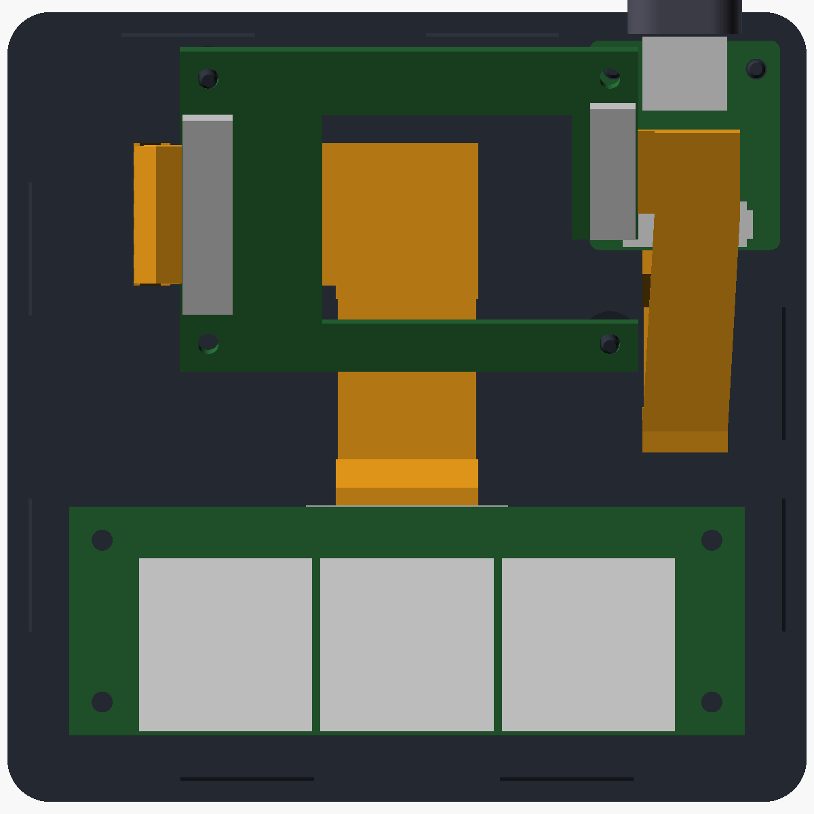
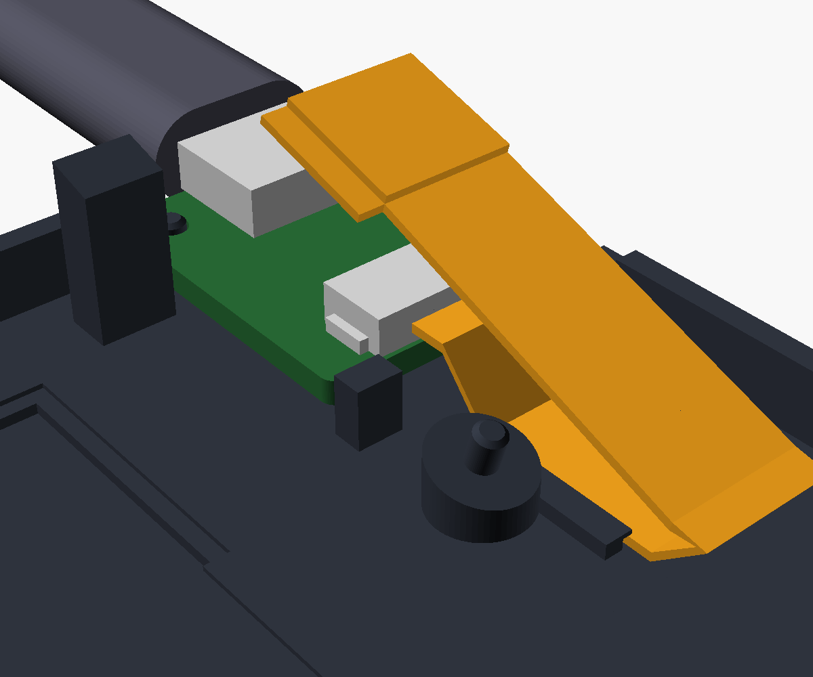

# OPad case V3

The case for the V3 boards (`hardware/pcb/V3`):
- the carrier under the Waveshare board;
- the USB board, on an 8-way FFC, with its USB-C through the rear wall;
- the three-key MX or Hall Effect module, on one 14-way FFC.

It is built on [V1.1](../V1.1/README.md). The coordinates and design approach are
the same; what changed is below. **Not printed or test-fitted yet**; the boards are not built either.







| | V1.1 | V3 |
|---|---|---|
| Footprint | 76 × 82.5 mm | **84 × 83 mm** |
| Height, key deck / rear | 12.0 / 33.3 mm | **11.6 / 35.3 mm** |
| Keys | 2 | **3** at 19.05 mm |
| Module mount | 2 pins + 2 clamp posts | **4 corner pins + 4 clamp posts** |
| Screen | glass flush, taped on a ledge, stack dropped in from the top | **stack inserted from below**, glass pressed up against a 1.2 mm lip (0.5 mm foam tape between them), so the glass sits 1.3 mm below the frame |
| Carrier support | 4 posts 0.5 mm below the carrier | **2 posts pressing the carrier up, with pins in its M2 holes, and a pad on its rear rail** |
| USB-C | through the right wall, into the Waveshare's own port | **through the rear wall, level, on the USB board** in the rear-right corner; the Waveshare's own port is closed in |
| Cables | JST SH, 100 mm | **14-way 1.0 mm FFC** to the module and **8-way 1.0 mm FFC** to the USB board, both held on the floor by **channels with small lips** |

## The USB board's seat

There are no screws, so the board is held from every side:
- **Down:** it sits on two posts on the bottom plate, 1.5 mm above the floor, with pins
  through its two M2 holes.
- **Up:** two blocks on the inside of the rear wall, either side of the jack, clamp its
  rear corners down onto the posts. Recesses in the blocks take the pin tips.
- **Plug pushed in:** the pins and two stops at the board's front corners take it. The
  stops sit either side of J2, clear of its cable.
- **Plug pulled out:** the rear wall takes it. The board's rear edge is 0.6 mm from the
  wall, and the pins stop it first.
- **Sideways:** the right wall on one side; on the other, a rib on the left block, and
  the pad that supports the carrier's rear rail.

The opening in the rear wall is a 12.8 × 7.3 mm stadium for a plug overmold up to
12 × 6.5 mm. The bottom plate's rim is cut away where the board lies against the rear
and right walls.

The carrier's right-rear M2 hole is right above the board, so there is no post there.
A pad presses the carrier's rear rail beside the board instead, clear of the socket
tails. The other two posts keep their pins.

## The cables

Both cables lie on the floor in channels. The channel walls are 1.0 mm high, either side
of the cable with 0.4 mm play, and have 0.6 mm lips the cable is pressed in under.

- **Module (14-way, 15 mm):** out of J_MOD at the carrier's left end, down past the
  stack, across the floor to the middle, one 45° fold, then forward into the module's J1.
  The route is about 70 mm.
- **USB (8-way, 9 mm):** out of J_USB on the carrier's lug towards the USB end, then:
  - one 45° fold 2 mm past the connector, where the cable's stiffened end stops;
  - forward in the free space right of the stack, over the USB board;
  - down in front of the board;
  - back along its channel on the floor, and up into J2 at the board's front edge.

  The route is about 60 mm between the mouths, 66 mm with both ends in their connectors.

## Parts

| Qty | Part | For |
|---|---|---|
| 1 | 14-way, 1.0 mm FFC, **80 mm** (100 mm also fits, with the extra folded into an S beside the stack), type A or B | carrier to module (LCSC C54350071 / C54350068 for 80 mm) |
| 1 | 8-way, 1.0 mm FFC, **80 mm** (a 70 mm one fits closer), type A or B | carrier to USB board (LCSC C54350099); the extra bows up in the space beside the stack |
| ~20 cm | 0.5 mm foam tape, 2–3 mm wide | under the lip, round the glass |
| 4 | Silicone bumper, Ø 12.7 mm, about 3.5 mm tall, self-adhesive | the foot recesses |

No screws or spacers.

## Assembly

1. Plug both FFCs into the carrier before the Waveshare goes on: the 14-way into J_MOD
   (top side, left end), the 8-way into J_USB (top side, on the lug, mouth towards the
   USB end). For each, slide the latch out, insert the cable, slide the latch back. Then
   plug the Waveshare onto the carrier's sockets.
2. Stick the foam tape round the underside of the window lip.
3. With the top case upside down, push the screen stack in from below, glass first,
   against the lip.
4. Fit the switches through the key deck into the module. The module goes under the
   deck, parts facing down, with J1 towards the screen; the four pins go through its
   corner holes.
5. Lay the USB board in the rear-right corner, parts facing down onto the two blocks,
   jack in the rear-wall opening, left edge against the rib.
6. Route the cables:
   - **module:** down past the carrier's left end, into its channel on the bottom
     plate, across towards the middle, one 45° fold at the corner so it runs straight
     forward into the module's J1;
   - **USB:** fold it 45° just past J_USB so it runs forward beside the stack, curl it
     down in front of the USB board, back along its channel and into J2;
   - press both in under their channels' small lips, so they cannot move;
   - fold any extra length into an S beside the stack.
7. Snap the bottom plate on. Its pins go through the USB board's holes. Its posts clamp
   the module against the deck, and press the carrier up so the glass bears on the lip.
   The plate comes off by prying at the rear notch.
8. Stick on the four feet.

## Checks

`tools/check_fit.py` intersects every part inside with both case halves. That covers:
- the screen stack, and the carrier with J_USB and its latch;
- J_MOD and its latch;
- the USB board with its jack, shell legs, J2, latch, parts and plug;
- the module and its parts, the switches and the keycaps;
- both FFCs, modelled as ribbons along their routes.

It also checks these pairs against each other:
- each cable against the stack, the boards and the other cable;
- the carrier's top-side parts and J_USB against the Waveshare's back;
- the USB board and its parts against the carrier above it.

Every part must render with some volume first, or its checks would mean nothing.
**All clear** (2026-10-29).

`tools/test_fit_mutations.py` breaks the case on purpose and expects the check to
catch it. **13 of 13 behave:**

| Deliberate fault | Caught as |
|---|---|
| V1.1's 0.6 mm floor clearance | the cable touches the socket tails |
| an 80 mm wide case | the USB cable runs into the right-front carrier post |
| a glass pocket smaller than the glass | glass against the top case |
| shorter sockets | the carrier's top parts hit the Waveshare's back |
| a cable channel narrower than the cable | cable against the bottom plate |
| channel walls 2 mm high | they hit the socket tails under the stack |
| module pins too wide for their holes | module against the top case |
| carrier pins too wide for their holes | carrier against the bottom plate |
| the USB board 0.6 mm higher | J2 hits the front of the carrier's lug |
| the USB board 1.1 mm lower | the jack's shell legs hit the floor |
| a USB opening smaller than the plug | plug against the top case |
| hold-down blocks 0.5 mm into the board | USB board against the top case |

The unmodified case passes.

```
python3 tools/check_fit.py              # about 30 s with OpenSCAD 2021.01
python3 tools/test_fit_mutations.py     # about 7 min
openscad -o osupad_case_top.stl    -D 'PART="top_case"'     osupad_enclosure.scad
openscad -o osupad_case_bottom.stl -D 'PART="bottom_plate"' osupad_enclosure.scad
```

What it cannot check:
- how the FFCs actually fold;
- the snap fit's feel, and how firmly the blocks clamp the USB board;
- the printer's tolerances;
- the USB-C shell legs' real length under the board (1.0 mm assumed).

Print it and test-fit before trusting the clearances below 0.5 mm. The tightest are:
- J2 under the front of the carrier's lug (0.36 mm);
- the USB cable beside the right-front carrier post (0.4 mm);
- the cable under the front of the stack.

## Printing

As V1.1:
- **Top case:** upright, open side down, with supports under the key deck, the screen
  pod and the USB hold-down blocks.
- **Bottom plate:** base down, no supports.
- **Material:** PLA or PETG.

## Files

| File | |
|---|---|
| `osupad_params.scad` | every dimension, the board-to-case coordinate conversions, the cable routes |
| `osupad_enclosure.scad` | the parts: `PART = "top_case"`, `"bottom_plate"` or `"assembly"` |
| `osupad_case_top.stl`, `osupad_case_bottom.stl` | print files |
| `osupad_render.png`, `osupad_inside.png`, `osupad_bottom_plate.png`, `osupad_usb.png` | assembled, from the rear; from above without the top case; the bottom plate; the USB board's corner |
| `tools/check_fit.py`, `tools/fit_check.scad` | the fit check |
| `tools/test_fit_mutations.py` | the deliberate faults |
| `tools/reference_models.scad` | everything inside, as envelopes (V3 carrier, USB board and modules, both FFC ribbons) |
| `tools/render_scene.scad` | the renders |
| `tools/waveshare_back.scad` | the Waveshare's back-side parts, from its STEP model (as V1.1) |
