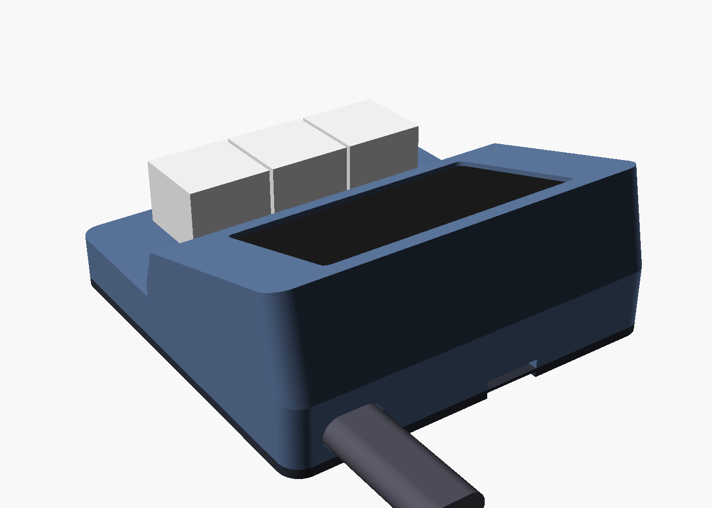
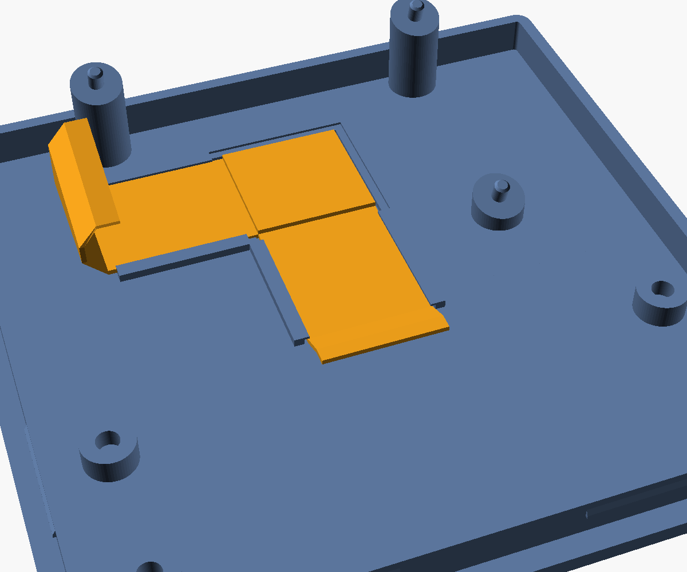

# OPad case V3

The case for the V3 boards (`hardware/pcb/V3`):
- the carrier, with its USB-C on a tab past the Waveshare's USB end;
- the three-key MX or Hall Effect module, on one 14-way FFC.

It is built on [V1.1](../V1.1/README.md). The coordinates and design approach are
the same; what changed is below. **Not printed or test-fitted yet**; the boards are not built either.





The bottom plate's L-shaped channel holds the module cable on the floor. Its walls are
1.0 mm high, either side of the 15 mm cable with 0.4 mm play, and have 0.6 mm lips the
cable is pressed in under. There are no lips at the corner, where the cable is folded
double. The walls are low enough to pass under the front of the screen stack.

| | V1.1 | V3 |
|---|---|---|
| Footprint | 76 × 82.5 mm | **84 × 83 mm** |
| Height, key deck / rear | 12.0 / 33.3 mm | **11.6 / 35.3 mm** |
| Keys | 2 | **3** at 19.05 mm |
| Module mount | 2 pins + 2 clamp posts | **4 corner pins + 4 clamp posts** |
| Screen | glass flush, taped on a ledge, stack dropped in from the top | **stack inserted from below**, glass pressed up against a 1.2 mm lip (0.5 mm foam tape between them), so the glass sits 1.3 mm below the frame |
| Carrier support | 4 posts 0.5 mm below the carrier | **3 posts pressing the carrier up, with pins in its M2 holes** |
| USB-C | through the right wall, into the Waveshare's own port | **through the rear wall**, into the carrier's port; the Waveshare's own port is closed in |
| Module cable | JST SH, 100 mm | **14-way 1.0 mm FFC**, about 70 mm route, held on the floor by a **channel on the bottom plate** |

**Why the screen goes in from below:** the V3 carrier is 62.5 mm long with its USB-C
tab, longer than the 59.2 mm glass. The stack cannot pass through the glass pocket
from the top any more. Pressing it up against a lip has three more advantages:
- the bottom-plate posts hold the stack in place;
- the posts' pins in the carrier's holes take the USB plug's push;
- no M2 spacers or screws are needed.

## Parts

| Qty | Part | For |
|---|---|---|
| 1 | 14-way, 1.0 mm FFC, **80 mm** (100 mm also fits, with the extra folded into an S beside the stack), type A or B | carrier to module (LCSC C54350071 / C54350068 for 80 mm) |
| ~20 cm | 0.5 mm foam tape, 2–3 mm wide | under the lip, round the glass |
| 4 | Silicone bumper, Ø 12.7 mm, about 3.5 mm tall, self-adhesive | the foot recesses |

No screws or spacers.

## Assembly

1. Plug the FFC into the carrier's J_MOD (top side, left end) before the Waveshare
   goes on: slide the latch out, insert the cable, slide the latch back. Then plug the
   Waveshare onto the carrier's sockets.
2. Stick the foam tape round the underside of the window lip.
3. With the top case upside down, push the screen stack in from below, glass first,
   against the lip.
4. Fit the switches through the key deck into the module. The module goes under the
   deck, parts facing down, with J1 towards the screen; the four pins go through its
   corner holes.
5. Route the cable:
   - down past the carrier's left end;
   - into the channel on the bottom plate, across towards the middle, with one 45°
     fold at the corner so it runs straight forward into the module's J1;
   - press it in under the channel's small lips, so it cannot move;
   - fold any extra length into an S beside the stack.
6. Snap the bottom plate on. Its posts clamp the module against the deck, and press
   the carrier up so the glass bears on the lip. The plate comes off by prying at the
   rear notch.
7. Stick on the four feet.

## Checks

`tools/check_fit.py` intersects every part inside with both case halves. That covers
the screen stack, the carrier with its tab, the USB-C and plug, J_MOD and its latch,
the module and its parts, the switches, the keycaps, and the FFC modelled as a 15 mm
ribbon along its route. It also checks these pairs against each other:
- the cable against the stack and the module;
- the carrier's top-side parts against the Waveshare's back.

Every part must render with some volume first, or its checks would mean nothing.
**All clear** (2026-10-24).

`tools/test_fit_mutations.py` breaks the case on purpose and expects the check to
catch it. **9 of 9 behave:**

| Deliberate fault | Caught as |
|---|---|
| V1.1's 0.6 mm floor clearance | the cable touches the socket tails |
| V1.1's 76 mm width | the USB-C tab hits the right wall |
| a glass pocket smaller than the glass | glass against the top case |
| shorter sockets | the carrier's top parts hit the Waveshare's back |
| module pins too wide for their holes | module against the top case |
| carrier pins too wide for their holes | carrier against the bottom plate |
| a cable channel narrower than the cable | cable against the bottom plate |
| channel walls 2 mm high | they hit the socket tails under the stack |

The unmodified case passes. A bug where the pair checks tested nothing was found by these cases and fixed.

```
python3 tools/check_fit.py              # about 20 s with OpenSCAD 2021.01
python3 tools/test_fit_mutations.py     # about 2 min
openscad -o osupad_case_top.stl    -D 'PART="top_case"'     osupad_enclosure.scad
openscad -o osupad_case_bottom.stl -D 'PART="bottom_plate"' osupad_enclosure.scad
```

What it cannot check:
- how the FFC actually folds;
- the snap fit's feel;
- the printer's tolerances.

Print it and test-fit before trusting the clearances below 0.5 mm. The tightest are
the cable under the front of the stack and the carrier's tab against the right wall.

## Printing

As V1.1:
- **Top case:** upright, open side down, with supports under the key deck and the screen pod.
- **Bottom plate:** base down, no supports.
- **Material:** PLA or PETG.

## Files

| File | |
|---|---|
| `osupad_params.scad` | every dimension, the board-to-case coordinate conversions, the cable route |
| `osupad_enclosure.scad` | the parts: `PART = "top_case"`, `"bottom_plate"` or `"assembly"` |
| `osupad_case_top.stl`, `osupad_case_bottom.stl` | print files |
| `osupad_render.png`, `osupad_inside.png`, `osupad_bottom_plate.png` | assembled; from above without the top case; the bottom plate with the cable in its channel |
| `tools/check_fit.py`, `tools/fit_check.scad` | the fit check |
| `tools/test_fit_mutations.py` | the deliberate faults |
| `tools/reference_models.scad` | everything inside, as envelopes (V3 carrier and modules, FFC ribbon) |
| `tools/render_scene.scad` | the renders |
| `tools/waveshare_back.scad` | the Waveshare's back-side parts, from its STEP model (as V1.1) |
