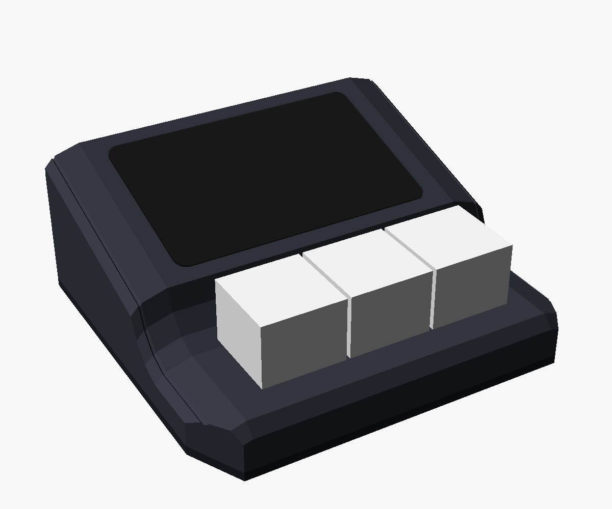
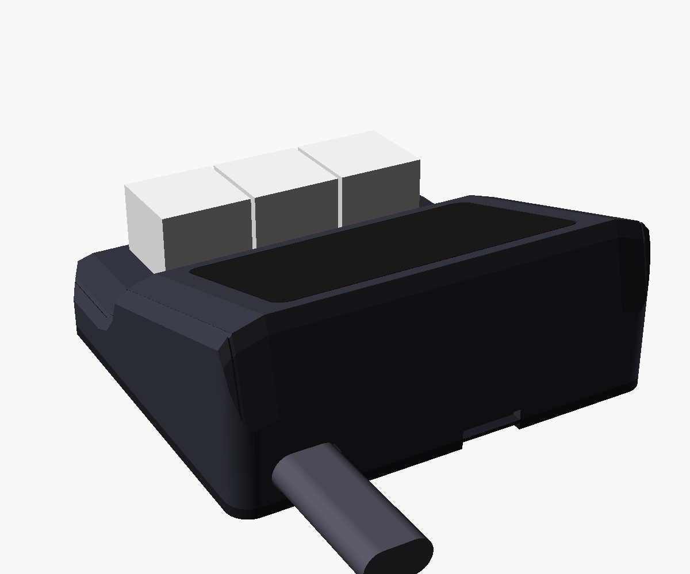
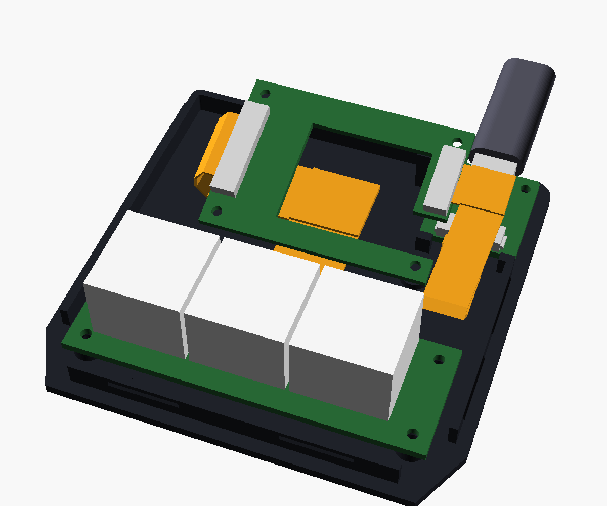
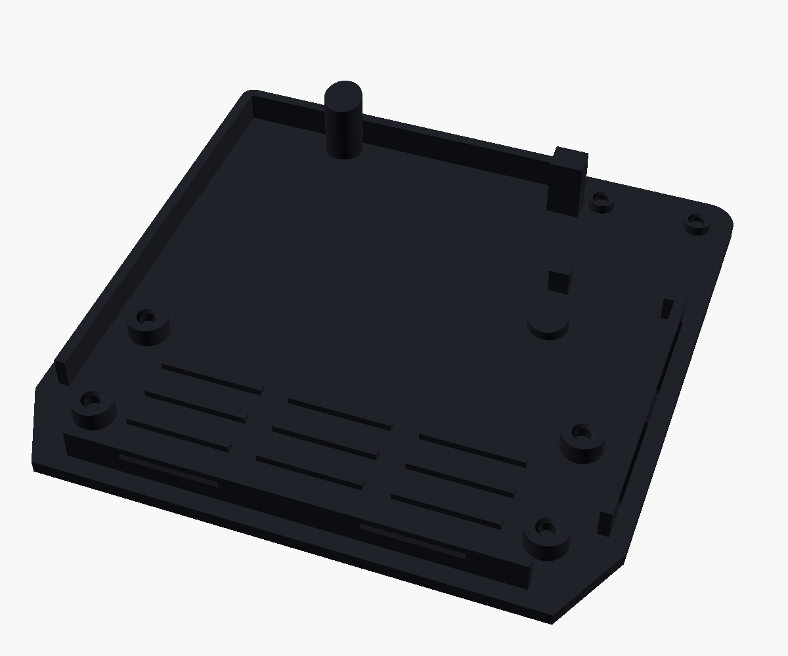
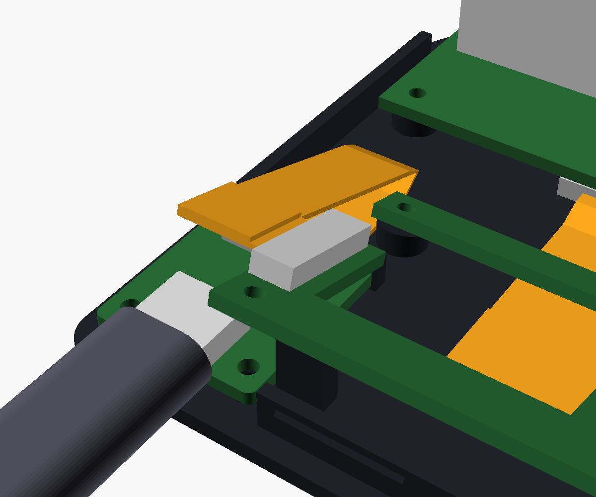

# OPad case V4

The case for the V3 boards (`hardware/pcb/V3`): the carrier, the USB board and the
three-key MX or Hall Effect module. It is the [V3 case](../V3/README.md) inside a new
faceted outside ("Stealth"); everything inside it (the glass pocket, pins, posts, USB
seat, snap fit, cables and assembly) is V3's. What changed is below.

**Not printed yet.** The fit check passes (see Checks); the outside and the bottom
plate's rim have not been test-fitted.











| | V3 | V4 |
|---|---|---|
| Outside | rounded box: flat key deck, a step up to the screen pod, rounded corners | **faceted**: two facets down each side with a V-groove on the crease, front corners cut off, a three-plane rise from the keys to the screen, two planes down the back |
| Footprint | 84 × 82.5 mm | same |
| Height, key deck / rear | 11.6 / 34.1 mm | same |
| Screen, keys, everything inside | | **unchanged**: same glass pocket (flush), key positions, cavity, pins, posts, USB seat, snaps and cables |
| Bottom plate | rounded rectangle | the top case's plan (cut front corners); the rim follows it and stops at the front corners |

## Outside

`opad_params.scad` ("V4 exterior") and `opad_enclosure.scad` (`outer_shell`):

- **Top line.** The side profile, front to rear (`TOP_LINE`): a 2.5 mm chamfer on the
  front edge, the flat key deck at 11.6 mm, a rise to the screen face in three planes
  (from 25 mm behind the front, clear of the keycaps), the 16° screen face, then two
  planes down the back to the rear wall. It lies on or outside V3's profile everywhere
  except the front chamfer, so the walls there are at least as thick as V3's.
- **Side facets.** That profile is swept across the width with a section whose sides
  are two facets (`SIDE_FACETS`): a steep one 4 mm high, 2 mm in, then a shallow one
  1.8 mm high, 6 mm wider. The screen frame keeps a flat border of about 4 mm beside
  the glass pocket.
- **Crease.** A V-groove (`CREASE_V`, a 0.8 mm square on its corner, 0.57 mm deep) runs
  along the crease between the facets on both sides. It can stay as a shadow line or be
  filled with paint or a strip of another colour.
- **Plan.** The front corners are cut off 6 mm along the front and 12 mm along the sides
  (`FRONT_CUT`); the rear corners stay rounded as V3's (a cut there would come within
  the wall of the USB board's corner).

**Walls.** The inside is V3's cavity, clipped to stay `WALL` (2.4 mm) inside the new
outside, sideways under the facets and in plan at the cut corners (`inner_clip`); the
module bosses and the USB hold-downs are cut to the outside too. At the crease the wall
is 1.8 mm under the groove.

**Bottom plate.** Its outline is the top case's plan. The rim follows it, `WALL + TOL`
inside, and is cut away at the two front corners: there the module's front corners
come within the rim's width of the wall.

**Limits found by the fit check:** a steep facet deeper than 4 mm (the concept had 6)
brings the wall inside it down onto the rim; much larger front cuts bring the wall into
the module. Both are mutation cases below.

## Screen

As V1.1: the glass sits in a pocket in the pod, its front flush with the frame, on
double-sided tape on the ledge round the opening. The pocket's walls (0.3 mm clearance)
stop it moving sideways. The Waveshare and the carrier drop through the opening from
the top; the opening is widened round the Waveshare's own USB-C, which stands out past
its PCB. The carrier supports stop 0.5 mm below the carrier: they only catch the stack
if the tape lets go.

## Module mount

Everything goes into the top case upside down, so the pins are on the top case. Four
bosses under the key deck carry pins that go through the module's four corner holes:
the module hangs on them, located, while the rest goes in. The pins go on 1.5 mm into
holes in four posts on the bottom plate, which clamp the module against the bosses
when the plate snaps on.

Three ribs per key on the bottom plate stop 0.1 mm under the MX sockets, so pushing a
switch into its socket does not bend the module. They clear every part of the HE
module by 0.5 mm or more.

## The USB board's seat

There are no screws, so the board is held from every side:
- **Located:** two pins on the blocks on the inside of the rear wall go through its two
  M2 holes and on 1.0 mm into holes in two posts on the bottom plate.
- **Down:** it sits on those posts, 1.5 mm above the floor.
- **Up:** the two blocks, either side of the jack, clamp its rear corners down onto the
  posts. A tab on the right wall over its front-right corner, clear of J2 and its
  parts, presses there too.
- **During assembly**, with the top case upside down, the board sits on the pins and
  lies level on the two blocks and the tab, its jack in the opening and its left edge
  against the rib. Its centre of mass is inside those three supports.
- **Plug pushed in:** the pins and two stops at the board's front corners take it. The
  stops sit either side of J2, clear of its cable.
- **Plug pulled out:** the rear wall takes it. The board's rear edge is 0.6 mm from the
  wall, and the pins stop it first.
- **Sideways:** the right wall on one side; on the other, a rib on the left block, and
  the pad that supports the carrier's rear rail.

The opening in the rear wall is a 12.8 × 7.3 mm stadium for a plug overmold up to
12 × 6.5 mm. The bottom plate's rim is cut away where the board lies against the rear
and right walls.

The carrier's right-rear M2 hole is right above the board, so there is no post there.
A pad under the carrier's rear rail beside the board takes its place, clear of the
socket tails.

## The cables

Both cables lie loose on the floor; there are no channels.

- **Module (14-way, 15 mm):** out of J_MOD at the carrier's left end, down past the
  stack, across the floor to the middle, one 45° fold, then forward into the module's J1.
  The route is about 70 mm.
- **USB (8-way, 9 mm):** out of J_USB on the carrier's lug towards the USB end, then:
  - one 45° fold 2 mm past the connector, where the cable's stiffened end stops;
  - forward in the free space right of the stack, over the USB board;
  - down in front of the board;
  - back along the floor, and up into J2 at the board's front edge.

  The route is about 60 mm between the mouths, 66 mm with both ends in their connectors.

## Parts

| Qty | Part | For |
|---|---|---|
| 1 | 14-way, 1.0 mm FFC, **80 mm** (100 mm also fits, with the extra folded into an S beside the stack), **type B** (contacts on opposite sides, "reverse") | carrier to module (LCSC C54350068 for 80 mm) |
| 1 | 8-way, 1.0 mm FFC, **80 mm** (a 70 mm one fits closer), **type A** (contacts on the same side) | carrier to USB board (LCSC C54350099); the extra bows up in the space beside the stack |
| ~20 cm | thin double-sided tape (about 0.15 mm), 2–3 mm wide | on the ledge, under the glass edge |
| 4 | Silicone bumper, Ø 12.7 mm, about 3.5 mm tall, self-adhesive | the foot recesses |

No screws or spacers.

The connectors are bottom contact: the cable's bare contacts face the board the connector is
on. Along these routes a bend keeps the same face against the same board side and each 45°
fold turns the cable over. The module cable leaves the carrier's top, turns under the stack
and folds once, so it reaches the module's underside with the other face up: type B. The
USB cable folds once and curls back once, so it reaches the USB board's top with the same
face down: type A. The built pads use these cables (2026-11-20).

## Assembly

Everything is wired before it goes into the case.

1. Plug both FFCs into the carrier: the 14-way into J_MOD (top side, left end), the
   8-way into J_USB (top side, on the lug, mouth towards the USB end). Plug the other
   ends into the module's J1 and the USB board's J2. For each, slide the latch out,
   insert the cable, slide the latch back. Fold each cable 45° where it will fold in the
   case, and crease it with a fingernail.
2. Plug the Waveshare onto the carrier's sockets.
3. Stick the tape on the ledge round the glass pocket. With the top case upright, pass
   the module and the USB board down through the screen opening from the top (the
   module end first, on edge: 24 × 4 mm goes through the 48.8 × 35.6 mm opening),
   then lay the glass in its pocket and press it onto the tape.
4. Turn the top case upside down. Put the module on the four pins under the key deck,
   J1 up and towards the screen. Put the USB board on the two pins in the rear-right
   corner, jack in the rear-wall opening, left edge against the rib. Lay the cables:
   - **module:** down past the carrier's left end, across the floor towards the
     middle, folded 45° so it runs straight into J1;
   - **USB:** forward beside the stack, curled down in front of the USB board and back
     into J2;
   - fold any extra length into an S beside the stack.
5. Put the bottom plate on and snap it shut. The pin tips go into the holes in its
   posts, which clamp the module and the USB board. The plate comes off by prying at
   the rear notch.
6. Turn it over and fit the switches from the top, through the key deck into the
   module. The ribs under the sockets take the push.
7. Stick on the four feet.

## Checks

As V3; the tools are V3's, run against this case.

`tools/check_fit.py` intersects every part inside with both case halves. That covers:
- the screen stack, and the carrier with J_USB and its latch;
- J_MOD and its latch;
- the USB board with its jack, shell legs, J2, latch, parts and plug;
- the module and its parts, the switches and the keycaps;
- both FFCs, modelled as ribbons along their routes.

It also checks these pairs against each other:
- each cable against the stack, the boards and the other cable;
- the carrier's top-side parts and J_USB against the Waveshare's back;
- the USB board and its parts against the carrier above it.

Every part must render with some volume first, or its checks would mean nothing.
**All clear** (2026-11-26).

`tools/test_fit_mutations.py` breaks the case on purpose and expects the check to
catch it. **16 of 16 behave:**

| Deliberate fault | Caught as |
|---|---|
| V1.1's 0.6 mm floor clearance | the cable touches the socket tails |
| an 80 mm wide case | the USB cable runs into the bottom plate |
| a glass pocket smaller than the glass | glass against the top case |
| shorter sockets | the carrier's top parts hit the Waveshare's back |
| module pins too wide for their holes | module against the top case |
| post holes narrower than the module pins | top case against the bottom plate |
| carrier supports up against the carrier | carrier against the bottom plate |
| USB pins too wide for the board's holes | USB board against the top case |
| socket ribs up into the MX sockets | sockets against the bottom plate |
| the USB board 0.6 mm higher | J2 hits the front of the carrier's lug |
| the USB board 1.1 mm lower | the jack's shell legs hit the floor |
| a USB opening smaller than the plug | plug against the top case |
| hold-down blocks 0.5 mm into the board | USB board against the top case |
| V4: side facets 6 mm deep | top case against the bottom plate's rim |
| V4: front corners cut 14 × 28 mm | module against the top case |

The unmodified case passes.

```
python3 tools/check_fit.py              # about 30 s with OpenSCAD 2021.01
python3 tools/test_fit_mutations.py     # about 7 min
openscad -o opad_case_top.stl    -D 'PART="top_case"'     opad_enclosure.scad
openscad -o opad_case_bottom.stl -D 'PART="bottom_plate"' opad_enclosure.scad
```

What it cannot check:
- how the FFCs actually fold;
- the snap fit's feel, and how firmly the blocks clamp the USB board;
- the printer's tolerances;
- the USB-C shell legs' real length under the board (1.0 mm assumed).

Check these on every new print before trusting the clearances below 0.5 mm. The tightest are:
- J2 under the front of the carrier's lug (0.36 mm);
- the USB cable beside the right-front carrier post;
- the cable under the front of the stack.

## Printing

As V1.1:
- **Top case:** upright, open side down, with supports under the key deck, the screen
  pod and the USB hold-down blocks.
- **Bottom plate:** base down, no supports.
- **V4's outside** needs no more supports: every facet and chamfer faces up and out,
  and the crease groove's upper face overhangs at 45°.
- **Material:** PETG for every case that leaves the bench (decided 2026-11-21). PLA
  softens near 55 °C (a car, a sunny window) and its snap fits are brittler; it is fine
  for fit checks only.

### Materials and where (owner's decisions, 2026-11-21)

| Material | Use | Notes |
|---|---|---|
| PETG, printed in-house | testers and the first batches | About 46 g a case (29 g top, 17 g bottom, from the STLs), so roughly 1 € of filament. Holds about 70–80 °C. Needs no enclosure. |
| MJF PA12 nylon (JLC3DP or a Craftcloud shop) | Kickstarter volumes, if a batch quote is worth it | Tough, takes heat, snap fits survive; ask for dyed black. Per-part minimums make single cases expensive: quote 50 at a time. Tolerance about ±0.2–0.3 mm, so print one set first and check the clearances below 0.5 mm. |
| ABS / ASA | not on the owner's printer | Need an enclosure (warp and layer cracks on an 84 × 82.5 mm part) and ventilation; ASA if ever, it warps less and takes the sun. |
| SLA / WJP resin | never for this case | Brittle: the snap fits break. |

Ordering PETG from a service is possible (5 cases on Craftcloud were quoted 33.01 €
on 2026-11-21) but buys nothing over printing it here except time. If ordered, ask the
shop to keep the STL's orientation, so the snap fits are not printed across their layers.

### PETG on the owner's Creality Ender-3 V3 KE (220 × 220 mm bed)

- **4 parts a plate** (2 × 2, about 5 mm apart): 5 cases (5 tops, 5 bottoms) are three
  plates, 4 + 4 + 2. Not all ten at once: one part coming loose late can take the plate
  with it, travel between many parts strings PETG, and the snap fits cool longer between
  layers.
- **Print one case first** and check it closes: PETG shrinks differently from PLA.
- **Start from Creality Print's generic PETG profile:** nozzle 230–250 °C, bed 70–85 °C,
  part fan lower than PLA, a little slower. Strings between parts: more retraction, or
  5 °C less at a time.
- **Bed:** the stock textured PEI releases PETG when it cools; no glue needed. On smooth
  PEI or glass use glue stick as a release layer, or PETG tears the surface.
- **Keep the filament dry:** a fresh spool comes vacuum sealed; store it in a sealed box
  or bag with silica gel. Popping, bubbles and strings mean it is wet: a filament dryer
  (or an oven at about 65 °C for 4–6 h, watched with a thermometer) fixes it. A
  dehumidifier is not needed.

## Files

| File | |
|---|---|
| `opad_params.scad` | every dimension, the board-to-case coordinate conversions, the cable routes |
| `opad_enclosure.scad` | the parts: `PART = "top_case"`, `"bottom_plate"`, `"assembly"` or `"side_by_side"` |
| `opad_case_top.stl`, `opad_case_bottom.stl` | print files |
| `opad_render.png`, `opad_rear.png`, `opad_inside.png`, `opad_bottom_plate.png`, `opad_usb.png` | assembled, from the front and from the rear; from above without the top case; the bottom plate; the USB board's corner |
| `tools/check_fit.py`, `tools/fit_check.scad` | the fit check |
| `tools/test_fit_mutations.py` | the deliberate faults |
| `tools/reference_models.scad` | everything inside, as envelopes (V3 carrier, USB board and modules, both FFC ribbons) |
| `tools/render_scene.scad` | the renders (`-D USE_STL=true` draws the case from the STLs: the CSG preview of the facets shows artefacts) |
| `tools/side_by_side.scad` | both case parts next to each other, for viewing (`PART = "side_by_side"`) |
| `tools/waveshare_back.scad` | the Waveshare's back-side parts, from its STEP model (as V1.1) |
